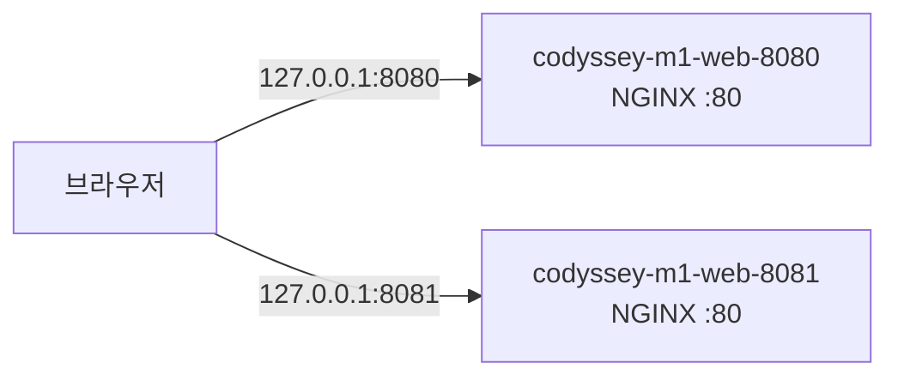
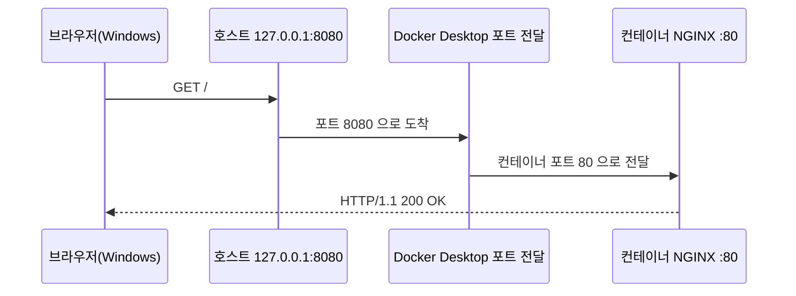
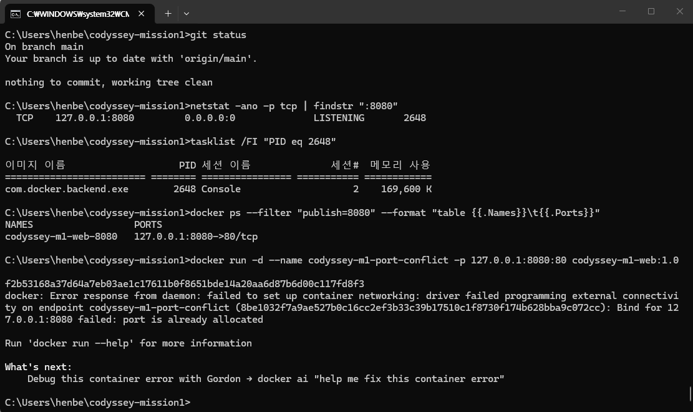
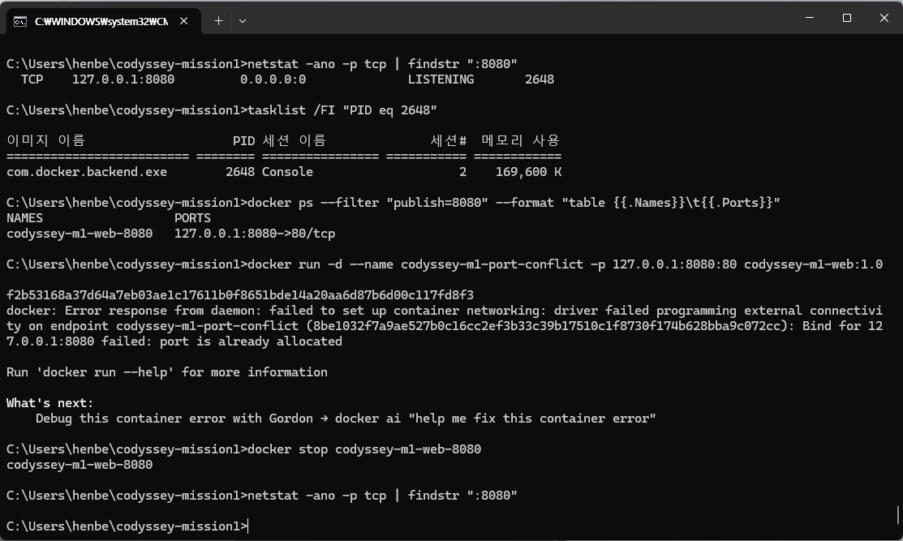
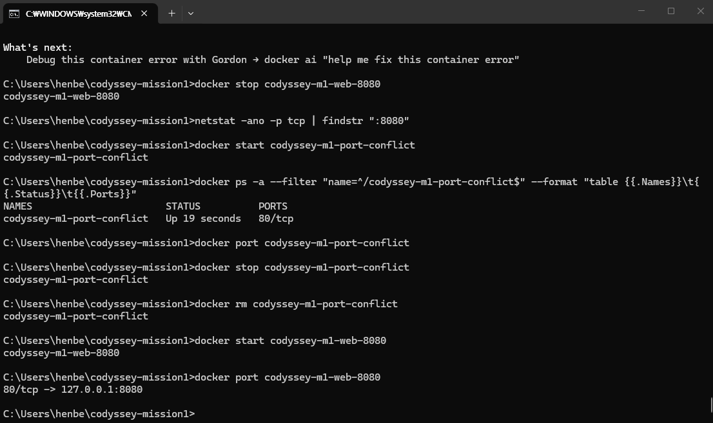
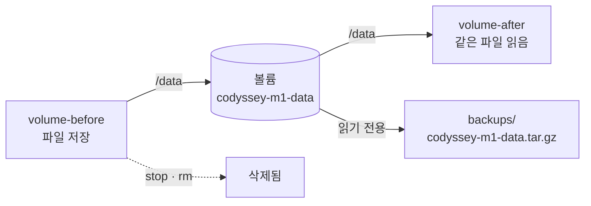
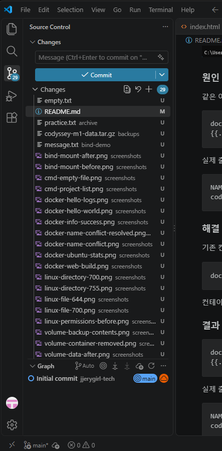

# 🛠️ 코디세이 미션 1 — 개발자 작업실 꾸미기


Windows CMD, Linux 권한, Docker, Git/GitHub 를 직접 실습하고, 실행한 명령과 실제 결과를 기록한 문서다.
모든 출력과 스크린샷은 내 PC 에서 직접 실행해 얻은 것이다.

> [!TIP]
> 처음부터 순서대로 읽으면 실습한 순서와 같다. 긴 출력은 ▶ 를 눌러 펼쳐 본다.

## 📑 목차

| 장 | 내용 |
|---|---|
| [0. 실행 환경](#0-실행-환경) | 버전·엔진 연결·진행 상태 |
| [1. Windows CMD 파일 관리](#1-windows-cmd-파일-관리) | 폴더·파일 만들기, 복사·이동·삭제, 경로 |
| [2. Linux 파일·디렉터리 권한](#2-linux-파일디렉터리-권한) | `chmod` 700·644·755 |
| [3. Docker 기본 실행과 운영](#3-docker-기본-실행과-운영) | 이미지·컨테이너·로그·자원, exec 와 attach |
| [4. Dockerfile 로 만든 웹 서버](#4-dockerfile-로-만든-웹-서버) | 빌드, 포트 매핑, 8080·8081 접속 |
| [5. 컨테이너 네트워크와 포트 충돌](#5-컨테이너-네트워크와-포트-충돌) | 네트워크 분리 원리, 충돌 진단·해제·복구 |
| [6. 볼륨 영속성과 백업](#6-볼륨-영속성과-백업) | 컨테이너를 지워도 남는 데이터, 백업 검증 |
| [7. 바인드 마운트 변경 반영](#7-바인드-마운트-변경-반영) | 호스트 파일 수정이 컨테이너에 바로 보임 |
| [8. Git 과 GitHub 연동](#8-git-과-github-연동) | 저장소 설정, VS Code 연동, 업로드 검증 |
| [9. 트러블슈팅 모음](#9-트러블슈팅-모음) | 겪은 오류 4건 |
| [10. 프로젝트 구조와 재현 방법](#10-프로젝트-구조와-재현-방법) | 파일 구성, 다시 해 보는 순서 |
| [11. AI 사전평가와 보완](#11-ai-사전평가와-보완) | 지적 2건과 보완 내용 |

---

## 0. 실행 환경

내가 직접 실행한 명령과 그 결과다.

| 확인 항목 | 명령 또는 확인 방법 | 실제 결과 |
|---|---|---|
| Windows 버전 | `ver` | 10.0.26200.9457 |
| Git 버전 | `git --version` | 2.56.0.windows.4 |
| VS Code 버전 | `code --version` | 1.144.0, x64 |
| Docker CLI 버전 | `docker --version` | 29.9.2, build a82e528 |
| Docker 엔진 | `docker info` | 연결 성공, Server Version 29.9.2 |
| Docker 운영 환경 | `docker info` | Docker Desktop, linux |
| WSL 상태 | `wsl --status` | 기본 배포 docker-desktop, 기본 버전 2 |
| CPU 가상화 | 작업 관리자 → 성능 → CPU | 사용 |

- 실습 셸은 Windows 명령 프롬프트(CMD)다.
- CMD 는 관리자 권한으로 실행하지 않았다.
- 원래 실행 중이던 컨테이너 1개와 이미지 1개는 확인만 하고 건드리지 않았다.

### Docker 엔진 연결 확인

Docker Desktop 을 실행한 뒤 `docker info` 로 엔진 연결을 확인했다.
아래 이미지는 `docker info --format` 으로 주요 정보만 요약해 출력한 결과다.
처음에는 연결에 실패했다 — [9-1](#9-1-docker-엔진-연결-실패) 에 기록했다.


### 진행 상태

| 항목 | 상태 |
|---|:---:|
| 실행 환경 및 Docker 엔진 연결 확인 | ✅ |
| 터미널 실습 로그 정리 | ✅ |
| Linux 파일·디렉터리 권한 실습 | ✅ |
| Docker 기본 실행 및 운영 | ✅ |
| Dockerfile 직접 작성 및 커스텀 이미지 실행 | ✅ |
| 포트 매핑 및 웹 접속 검증 | ✅ |
| 바인드 마운트 변경 반영 | ✅ |
| 볼륨 영속성 및 백업 검증 | ✅ |
| 트러블슈팅 2건 이상 기록 | ✅ |
| Git 설정 및 VS Code GitHub 연동 | ✅ |
| 최초 GitHub 업로드 및 웹페이지 표시 확인 | ✅ |
| 후속 증거 업로드 및 최종 점검 | ⬜ |

---

## 1. Windows CMD 파일 관리

아래 명령을 순서대로 직접 실행했다. 출력이 없는 명령은 뒤이은 조회로 결과를 확인했다.

| 명령 | 확인 결과 |
|---|---|
| `cd` | 현재 위치 `C:\Users\henbe` 확인 |
| `dir` | 일반 목록과 `<DIR>` 표시 확인 |
| `dir /a` | 일반 목록보다 항목이 늘어남을 확인 |
| `dir /a "C:\Users\henbe\codyssey-mission1"` | 생성 전 “파일을 찾을 수 없습니다.” 확인 |
| `mkdir "C:\Users\henbe\codyssey-mission1"` | 이후 폴더 이동 성공으로 생성 확인 |
| `cd codyssey-mission1` | 입력 줄이 프로젝트 경로로 변경됨 |
| `echo Hello Codyssey> practice.txt` | 이후 `type`으로 내용 확인 |
| `type practice.txt` | `Hello Codyssey` 출력 확인 |
| `type nul > empty.txt` | 이후 `dir empty.txt`로 0바이트 확인 |
| `copy practice.txt practice-copy.txt` | 복사 성공 메시지 확인 |
| `type practice-copy.txt` | 원본과 같은 내용 출력 확인 |
| `move practice-copy.txt practice-renamed.txt` | 이동 성공 메시지 확인 |
| `dir practice*.txt` | 원본과 이름 변경된 파일 확인 |
| `del practice-renamed.txt` | 이후 목록에서 원본만 남았음을 확인 |
| `mkdir archive` | 이후 파일 이동 성공으로 폴더 사용 확인 |
| `move practice.txt archive\` | 이동 성공 메시지 확인 |
| `type archive\practice.txt` | `Hello Codyssey` 출력 확인 |
| `type "C:\Users\henbe\codyssey-mission1\archive\practice.txt"` | 같은 내용 출력 확인 |

이름을 바꾼 뒤 `dir practice*.txt` 의 실제 출력:
```text
2026-11-01  오후 12:46                16 practice-renamed.txt
2026-11-01  오후 12:46                16 practice.txt
               2개 파일                  32 바이트
```

### 빈 파일 만들기

`type nul > empty.txt` 로 빈 파일을 만들었다.
`dir empty.txt` 출력에서 파일 크기가 0바이트임을 확인했다.


### 절대 경로와 상대 경로

| 구분 | 경로 |
|---|---|
| 절대 경로 | `C:\Users\henbe\codyssey-mission1\archive\practice.txt` |
| 상대 경로(프로젝트 폴더 기준) | `archive\practice.txt` |

두 경로로 같은 파일을 읽어 둘 다 `Hello Codyssey` 가 출력됨을 확인했다.

> [!NOTE]
> 다른 PC 에서는 절대 경로의 사용자 폴더(`henbe`) 부분을 그 환경에 맞게 바꿔야 한다.

### 프로젝트 목록 확인

프로젝트 폴더에서 실행했다.
```cmd
dir /a
```

실제 출력:
```text
2026-11-01  오후 12:55    <DIR>          .
2026-11-01  오후 12:45    <DIR>          ..
2026-11-01  오후 12:51    <DIR>          archive
2026-11-01  오후 12:47                 0 empty.txt
2026-11-01  오후 01:03             4,366 README.md
2026-11-01  오후 12:58    <DIR>          screenshots
               2개 파일               4,366 바이트
```

`empty.txt` 가 0바이트이고, 프로젝트 폴더와 README 가 있음을 확인했다.
이 출력은 조회한 때의 상태다. 이후 문서를 고치면서 파일 크기는 달라질 수 있다.


---

## 2. Linux 파일·디렉터리 권한

직접 만든 Ubuntu 컨테이너 `codyssey-m1-lab`([3장](#3-docker-기본-실행과-운영)) 안에서 실습했다.
작업 경로는 `/root/mission1-permissions`, 사용자는 `root` 다.

### 준비

```bash
mkdir /root/mission1-permissions
cd /root/mission1-permissions
touch sample.txt
mkdir sample-dir
ls -ld sample.txt sample-dir
```

바꾸기 전 실제 출력:
```text
drwxr-xr-x 2 root root 4096 Nov  1 04:19 sample-dir
-rw-r--r-- 1 root root    0 Nov  1 04:19 sample.txt
```


### 파일 권한 바꾸기

```bash
chmod 700 sample.txt
ls -l sample.txt
```

실제 출력:
```text
-rwx------ 1 root root 0 Nov  1 04:19 sample.txt
```


```bash
chmod 644 sample.txt
ls -l sample.txt
```

실제 출력:
```text
-rw-r--r-- 1 root root 0 Nov  1 04:19 sample.txt
```


### 디렉터리 권한 바꾸기

```bash
chmod 700 sample-dir
ls -ld sample-dir
```

실제 출력:
```text
drwx------ 2 root root 4096 Nov  1 04:19 sample-dir
```


```bash
chmod 755 sample-dir
ls -ld sample-dir
```

실제 출력:
```text
drwxr-xr-x 2 root root 4096 Nov  1 04:19 sample-dir
```


### 권한 숫자 읽는 법

권한은 소유자·그룹·다른 사용자 순서로 표시한다.
각 자리의 숫자는 `r=4`, `w=2`, `x=1` 을 더한 값이다.

| 숫자 | 표시 | 소유자 | 그룹·다른 사용자 |
|---|---|---|---|
| 700 | `rwx------` | 읽기·쓰기·실행(접근) | 없음 |
| 644 | `rw-r--r--` | 읽기·쓰기 | 읽기 |
| 755 | `rwxr-xr-x` | 읽기·쓰기·실행(접근) | 읽기·실행(접근) |

디렉터리에서는 뜻이 조금 다르다.
`r` 은 항목 목록 읽기, `w` 는 항목 만들기·지우기, `x` 는 안으로 들어가기다.

> [!NOTE]
> 이번 실습은 권한 표시가 바뀌는 것을 확인했다. 다른 사용자로 실제 접근을 시험하지는 않았다.

---

## 3. Docker 기본 실행과 운영

### Ubuntu 이미지 받기

```cmd
docker pull ubuntu:22.04
```

실제 출력:
```text
22.04: Pulling from library/ubuntu
Digest: sha256:076e7bf82319619f28dd0aa9c02ab34b055ad37100395b4f49a2ffba04fb5e11
Status: Image is up to date for ubuntu:22.04
docker.io/library/ubuntu:22.04
```

### 실습 컨테이너 만들기

```cmd
docker run -d --name codyssey-m1-lab ubuntu:22.04 sleep infinity
```

컨테이너 ID 가 출력됐다. 이어서 상태를 확인했다.

```cmd
docker ps -a --filter "name=^/codyssey-m1-lab$" --format "table {{.Names}}\t{{.Image}}\t{{.Status}}"
```

실제 출력:
```text
NAMES             IMAGE          STATUS
codyssey-m1-lab   ubuntu:22.04   Up 35 seconds
```

### hello-world 실행과 정상 종료

```cmd
docker run --name codyssey-m1-hello hello-world
```

`Hello from Docker!` 출력을 확인했다.


```cmd
docker ps -a --filter "name=^/codyssey-m1-hello$" --format "table {{.Names}}\t{{.Status}}"
```

실제 출력:
```text
NAMES               STATUS
codyssey-m1-hello   Exited (0) 2 minutes ago
```

종료 코드 0 — 정상 종료했다.

### 이미지 목록

```cmd
docker images
```

실제 출력:
```text
IMAGE                ID             DISK USAGE   CONTENT SIZE   EXTRA
hello-world:latest   c567b231f656       25.9kB         9.49kB    U
ubuntu:22.04         076e7bf82319        119MB         31.7MB    U
```

이미지는 실행에 쓰는 재료(READY)이고, 컨테이너는 이미지로 만든 실행 개체(GO)로 이해했다.

### 로그 보기

```cmd
docker logs codyssey-m1-hello
```

종료된 컨테이너에서도 `Hello from Docker!` 안내문을 다시 볼 수 있었다.


### 자원 사용량

```cmd
docker stats --no-stream codyssey-m1-lab
```

<details>
<summary>실제 출력</summary>

```text
CONTAINER ID   NAME              CPU %     MEM USAGE / LIMIT     MEM %     NET I/O         BLOCK I/O        PIDS
867c38f09508   codyssey-m1-lab   0.00%     4.531MiB / 7.666GiB   0.06%     1.74kB / 126B   7.22MB / 4.1kB   1
```

</details>

수치는 조회한 때의 값이다.


### 중지와 재시작

```cmd
docker stop codyssey-m1-lab
```

실제 출력:
```text
codyssey-m1-lab
```

```cmd
docker ps -a --filter "name=^/codyssey-m1-lab$" --format "table {{.Names}}\t{{.Status}}"
```

실제 출력:
```text
NAMES             STATUS
codyssey-m1-lab   Exited (137) 19 seconds ago
```

중지 상태를 확인했다. 종료 코드 137 이 나온 정확한 원인은 따로 확정하지 않았다.

```cmd
docker start codyssey-m1-lab
```

실제 출력:
```text
codyssey-m1-lab
```

```cmd
docker ps --filter "name=^/codyssey-m1-lab$" --format "table {{.Names}}\t{{.Status}}"
```

실제 출력:
```text
NAMES             STATUS
codyssey-m1-lab   Up 25 seconds
```

### 재시작 뒤에도 파일이 남았나

```cmd
docker exec codyssey-m1-lab ls -ld /root/mission1-permissions/sample.txt /root/mission1-permissions/sample-dir
```

실제 출력:
```text
drwxr-xr-x 2 root root 4096 Nov  1 04:19 /root/mission1-permissions/sample-dir
-rw-r--r-- 1 root root    0 Nov  1 04:19 /root/mission1-permissions/sample.txt
```

같은 컨테이너를 멈췄다 다시 켜도 [2장](#2-linux-파일디렉터리-권한)의 파일과 권한이 그대로 남았다.
컨테이너를 **지운** 뒤의 데이터는 [6장 볼륨](#6-볼륨-영속성과-백업)에서 따로 검증했다.

### 컨테이너 안에서 목록 보기

Ubuntu 컨테이너의 `/` 에서 실행했다.

```bash
ls
```

실제 출력:
```text
bin  boot  dev  etc  home  lib  lib32  lib64  libx32  media  mnt  opt  proc  root  run  sbin  srv  sys  tmp  usr  var
```

```bash
ls -a
```

실제 출력:
```text
.   .dockerenv  boot  etc   lib    lib64   media  opt   root  sbin  sys  usr
..  bin         dev   home  lib32  libx32  mnt    proc  run   srv   tmp  var
```

`-a` 를 붙이자 숨김 항목 `.dockerenv` 도 보였다.

```bash
ls -l
```

실제 출력 발췌:
```text
lrwxrwxrwx   1 root root    7 Oct 20 17:07 bin -> usr/bin
drwxr-xr-x   2 root root 4096 Apr 18  2022 boot
drwxr-xr-x   5 root root  340 Nov  1 04:11 dev
```

`-l` 로 권한·소유자·크기를 확인했다. 맨 앞 `l` 은 심볼릭 링크, `d` 는 디렉터리다.

### exec 와 attach 비교

| | `docker exec` | `docker attach` |
|---|---|---|
| 하는 일 | 실행 중인 컨테이너에 **새** 명령·셸을 띄운다 | 컨테이너의 **원래** 기본 프로세스에 연결한다 |
| 이번 결과 | Bash 를 열고 명령을 실행했다 | 새 입력 줄 없이 대기했다(`sleep infinity`) |
| 끝낸 뒤 | 컨테이너 유지 | 이번에는 컨테이너 유지 |

컨테이너가 계속 살아 있는지는 기본 프로세스의 상태에 따라 달라진다.

#### exec — 새 셸 실행

Windows CMD 에서 실행:
```cmd
docker exec -it codyssey-m1-lab bash
```

컨테이너 안에서 실행:
```bash
pwd
```

실제 출력:
```text
/
```

```bash
whoami
```

실제 출력:
```text
root
```

```bash
echo "Hello from Ubuntu"
```

실제 출력:
```text
Hello from Ubuntu
```

```bash
exit
```

Windows CMD 로 돌아와 실행:
```cmd
docker ps --filter "name=^/codyssey-m1-lab$" --format "table {{.Names}}\t{{.Status}}"
```

실제 출력:
```text
NAMES             STATUS
codyssey-m1-lab   Up 20 minutes
```

`exec` 로 연 Bash 를 끝내도 기본 프로세스 `sleep infinity` 는 그대로 돌았다.

#### attach — 기본 프로세스에 연결

Windows CMD 에서 실행:
```cmd
docker attach --sig-proxy=false codyssey-m1-lab
```

새 셸 입력 줄은 나타나지 않고 대기했다.
기본 프로세스가 출력 없이 기다리는 `sleep infinity` 이기 때문이다.

Ctrl+C 로 연결을 끝내자 다음 메시지가 나왔다.
```text
got 3 SIGTERM/SIGINTs, forcefully exiting
```

연결을 끝낸 뒤 확인:
```cmd
docker ps -a --filter "name=^/codyssey-m1-lab$" --format "table {{.Names}}\t{{.Status}}"
```

실제 출력:
```text
NAMES             STATUS
codyssey-m1-lab   Up 2 minutes
```

이번에는 attach 를 끝낸 뒤에도 컨테이너가 유지됐다.
`--sig-proxy=false` 는 터미널의 신호를 컨테이너로 전달하지 않게 하는 옵션이다.

---

## 4. Dockerfile 로 만든 웹 서버

### 소스와 베이스 이미지

| 항목 | 내용 |
|---|---|
| 소스 | [Dockerfile](web/Dockerfile) · [웹페이지](web/index.html) — 둘 다 직접 작성 |
| 베이스 이미지 | `nginx:stable-alpine` |
| 고른 이유 | 정적 HTML 을 내보낼 NGINX 가 들어 있고, Alpine 기반이라 가벼워 간단한 웹 서버 실습에 알맞다 |
| 바꾼 것 | `COPY` 로 기본 페이지를 내 HTML 로 교체, `LABEL` 로 프로젝트 제목 기록 |
| `EXPOSE 80` | 포트를 문서로 남길 뿐이다. 실제 호스트 연결은 실행할 때 `-p` 로 정했다 |

### 빌드

프로젝트 최상위 폴더에서 실행했다.
```cmd
docker build -t codyssey-m1-web:1.0 ./web
```

빌드 성공 출력 발췌:
```text
=> [2/2] COPY index.html /usr/share/nginx/html/index.html
=> => naming to docker.io/library/codyssey-m1-web:1.0
=> => unpacking to docker.io/library/codyssey-m1-web:1.0
```


이미지 확인:
```cmd
docker images codyssey-m1-web:1.0
```

실제 출력:
```text
IMAGE                 ID             DISK USAGE   CONTENT SIZE   EXTRA
codyssey-m1-web:1.0   4339a92483df       92.7MB         26.1MB
```

### 안쪽 서버 설정 확인

```cmd
docker run --rm --entrypoint nginx codyssey-m1-web:1.0 -T
```

실제 출력 발췌:
```text
nginx: the configuration file /etc/nginx/nginx.conf syntax is ok
nginx: configuration file /etc/nginx/nginx.conf test is successful
    listen       80;
        root   /usr/share/nginx/html;
```

안쪽 서버 포트는 80 이고, HTML 을 내보내는 경로가 `COPY` 대상과 같음을 확인했다.

### 포트 매핑과 실행



```cmd
docker run -d --name codyssey-m1-web-8080 -p 127.0.0.1:8080:80 codyssey-m1-web:1.0
```

```cmd
docker ps -a --filter "name=^/codyssey-m1-web-8080$" --format "table {{.Names}}\t{{.Status}}\t{{.Ports}}"
```

실제 출력:
```text
NAMES                  STATUS          PORTS
codyssey-m1-web-8080   Up 18 seconds   127.0.0.1:8080->80/tcp
```

```cmd
curl -i http://127.0.0.1:8080
```

실제 응답 발췌:
```text
HTTP/1.1 200 OK
Server: nginx/1.30.6
Content-Type: text/html

  <h1>나의 첫 Docker 웹 서버</h1>
  <p>Hello Codyssey!</p>
  <p>NGINX 기반 커스텀 이미지로 실행한 페이지입니다.</p>
  <p id="version">페이지 버전: 1</p>
```

브라우저에서 `http://localhost:8080` 접속을 확인했다.


### 웹 서버 로그

```cmd
docker logs --tail 20 codyssey-m1-web-8080
```

<details>
<summary>실제 로그</summary>

```text
172.17.0.1 - - [01/Nov/2026:04:58:51 +0000] "GET / HTTP/1.1" 200 402 "-" "Mozilla/5.0 (Windows NT 10.0; Win64; x64) AppleWebKit/537.36 (KHTML, like Gecko) Chrome/156.0.0.0 Safari/537.36" "-"
```

</details>

### 두 번째 호스트 포트

```cmd
docker run -d --name codyssey-m1-web-8081 -p 127.0.0.1:8081:80 codyssey-m1-web:1.0
```

```cmd
docker ps -a --filter "name=^/codyssey-m1-web-8081$" --format "table {{.Names}}\t{{.Status}}\t{{.Ports}}"
```

실제 출력:
```text
NAMES                  STATUS          PORTS
codyssey-m1-web-8081   Up 19 seconds   127.0.0.1:8081->80/tcp
```

```cmd
curl -i http://127.0.0.1:8081
```

실제 응답 발췌:
```text
HTTP/1.1 200 OK
 <p>Hello Codyssey!</p>
```

브라우저에서 `http://localhost:8081` 접속도 확인했다.


### 포트 매핑을 쓰는 이유

- 호스트 포트는 Windows 에서 들어가는 입구다.
- 컨테이너 포트는 안쪽 서버가 요청을 받는 자리다.
- 두 컨테이너의 NGINX 는 모두 안쪽 포트 80 을 쓴다. 호스트에서는 서로 다른 8080 과 8081 로 연결했다.
- `127.0.0.1` 에 묶어 이 PC 에서만 접속하게 했다.

---

## 5. 컨테이너 네트워크와 포트 충돌

### 네트워크 네임스페이스

네트워크 네임스페이스는 네트워크 환경을 나누는 Linux 기능이다.
이번에 쓴 기본 bridge 네트워크에서 각 컨테이너는 자기만의 네트워크 인터페이스, IP 주소,
라우팅 정보, 포트 공간을 가진다.

- 그래서 두 컨테이너의 NGINX 가 모두 안쪽 포트 80 을 써도 서로 충돌하지 않는다.
- 컨테이너 안의 localhost 는 그 컨테이너 자신이다. Windows 의 localhost 와는 다른 네트워크 공간이다.

### 호스트와 컨테이너의 포트 연결

| Windows 호스트 주소 | 연결 대상 | 컨테이너 안쪽 포트 |
|---|---|---|
| 127.0.0.1:8080 | codyssey-m1-web-8080 | 80 |
| 127.0.0.1:8081 | codyssey-m1-web-8081 | 80 |

실행 옵션 `-p 127.0.0.1:8080:80` 은 이렇게 읽는다.

| 부분 | 뜻 |
|---|---|
| `127.0.0.1` | Windows 호스트에서 접속할 루프백 주소 |
| `8080` | 호스트에서 접속할 포트 |
| `80` | 컨테이너 안 NGINX 가 요청을 받는 포트 |



브라우저 요청은 Windows 호스트 포트에 도착한 뒤, Docker Desktop 의 포트 전달 기능으로 그 컨테이너에 전해진다.
이렇게 나뉜 네트워크 공간 사이에 접속 길을 내는 것이 포트 매핑이다.
Docker 의 Linux bridge 네트워크에서는 주소·포트 변환과 방화벽 규칙이 이 연결에 쓰인다.

### 확인한 결과와 접속 범위

- 8080 과 8081 에서 각각 HTTP 200 OK 응답을 확인했다. 브라우저에도 직접 만든 웹페이지가 보였다.
- 호스트 포트는 서로 다른 8080 과 8081 을 썼다. 같은 호스트 주소·TCP 포트를 두 번 할당하면 충돌할 수 있다.
- 127.0.0.1 에 묶었으므로 이 PC 에서만 접속하는 설정이다. 다른 PC 에서 접속하는 실험은 하지 않았다.

참고 문서: [Docker 네트워크 개요](https://docs.docker.com/engine/network/) ·
[Docker 포트 공개와 매핑](https://docs.docker.com/engine/network/port-publishing/)

### 포트 충돌 진단·해제·복구

AI 사전평가에서 포트 충돌 진단 설명이 부족하다는 지적을 받았다([11장](#11-ai-사전평가와-보완)).
그래서 직접 만든 컨테이너로 충돌을 일부러 재현했다.


#### ① 포트와 프로세스 확인

Windows CMD 에서 실행:
```cmd
netstat -ano -p tcp | findstr ":8080"
```

실제 출력:
```text
TCP    127.0.0.1:8080    0.0.0.0:0    LISTENING    2648
```

```cmd
tasklist /FI "PID eq 2648"
```

프로세스는 `com.docker.backend.exe`, PID 는 `2648` 이었다.

> [!NOTE]
> PID 는 실행할 때마다 달라진다. 다시 해 볼 때는 PID 를 새로 조회한다.

Docker 백엔드 전체를 끄지 않고, 그 포트를 쓰는 컨테이너를 찾았다.

```cmd
docker ps --filter "publish=8080" --format "table {{.Names}}\t{{.Ports}}"
```

실제 출력:
```text
NAMES                  PORTS
codyssey-m1-web-8080   127.0.0.1:8080->80/tcp
```

#### ② 충돌 재현

```cmd
docker run -d --name codyssey-m1-port-conflict -p 127.0.0.1:8080:80 codyssey-m1-web:1.0
```

실제 오류 핵심 부분:
```text
Bind for 127.0.0.1:8080 failed: port is already allocated
```

기존 컨테이너가 같은 호스트 주소·포트를 쓰고 있어 실패했다.
컨테이너 ID 가 먼저 출력됐지만, 실행 성공으로 보지 않았다.



#### ③ 포트 해제

내가 만든 기존 웹 컨테이너만 멈췄다.

```cmd
docker stop codyssey-m1-web-8080
```

실제 출력:
```text
codyssey-m1-web-8080
```

```cmd
netstat -ano -p tcp | findstr ":8080"
```

출력이 없었다 — 그 포트의 수신(LISTENING) 행이 사라졌다.



#### ④ 재시도와 추가 관찰

```cmd
docker start codyssey-m1-port-conflict
```

컨테이너 이름이 출력됐다.

```cmd
docker ps -a --filter "name=^/codyssey-m1-port-conflict$" --format "table {{.Names}}\t{{.Status}}\t{{.Ports}}"
```

실제 출력:
```text
NAMES                       STATUS          PORTS
codyssey-m1-port-conflict   Up 19 seconds   80/tcp
```

```cmd
docker port codyssey-m1-port-conflict
```

출력이 없었다. 컨테이너는 실행됐지만 호스트 포트 매핑이 보이지 않아, 해결 성공으로 기록하지 않았다.
이 현상의 정확한 원인은 확정하지 않았다.

#### ⑤ 테스트 컨테이너 정리와 기존 서버 복구

```cmd
docker stop codyssey-m1-port-conflict
docker rm codyssey-m1-port-conflict
docker start codyssey-m1-web-8080
```

각 명령의 정상 출력을 확인했다.
다른 사용자의 컨테이너나 Docker 백엔드 프로세스는 끄지 않았다.

```cmd
docker port codyssey-m1-web-8080
```

실제 출력:
```text
80/tcp -> 127.0.0.1:8080
```



```cmd
curl -i http://127.0.0.1:8080
```

실제 응답 발췌:
```text
HTTP/1.1 200 OK
Server: nginx/1.30.6

  <p>Hello Codyssey!</p>
```

포트 매핑과 웹 응답이 모두 돌아왔다.

> [!TIP]
> 포트가 충돌하면 먼저 그 포트를 쓰는 프로세스와 컨테이너를 확인한다.
> 그다음 **내 자원만** 멈추거나, 비어 있는 다른 호스트 포트로 바꾼다.

---

## 6. 볼륨 영속성과 백업



### 볼륨 만들고 연결하기

```cmd
docker volume create codyssey-m1-data
```

실제 출력:
```text
codyssey-m1-data
```

```cmd
docker run -d --name codyssey-m1-volume-before --mount type=volume,source=codyssey-m1-data,target=/data ubuntu:22.04 sleep infinity
```

컨테이너 ID 가 출력됐다.

```cmd
docker inspect --format "{{range .Mounts}}{{.Type}} | {{.Name}} | {{.Destination}}{{end}}" codyssey-m1-volume-before
```

실제 출력:
```text
volume | codyssey-m1-data | /data
```

### 데이터 저장

```cmd
docker exec codyssey-m1-volume-before sh -c "echo Codyssey volume persistence test > /data/message.txt"
```

```cmd
docker exec codyssey-m1-volume-before cat /data/message.txt
```

실제 출력:
```text
Codyssey volume persistence test
```


### 첫 컨테이너 지우기

```cmd
docker stop codyssey-m1-volume-before
```

중지 명령이 성공했다.

```cmd
docker rm codyssey-m1-volume-before
```

실제 출력:
```text
codyssey-m1-volume-before
```

```cmd
docker ps -a --filter "name=^/codyssey-m1-volume-before$" --format "table {{.Names}}\t{{.Status}}"
```

제목 줄만 나오고 컨테이너 행은 없었다.


### 새 컨테이너에서 데이터 확인

```cmd
docker run -d --name codyssey-m1-volume-after --mount type=volume,source=codyssey-m1-data,target=/data ubuntu:22.04 sleep infinity
```

컨테이너 ID 가 출력됐다.

```cmd
docker exec codyssey-m1-volume-after cat /data/message.txt
```

실제 출력:
```text
Codyssey volume persistence test
```


첫 컨테이너를 지운 뒤 새 컨테이너에 같은 볼륨을 연결해도 데이터가 남아 있었다.
볼륨은 컨테이너와 따로 관리되는 영속 저장소다.

### 볼륨 백업

프로젝트 최상위 폴더의 Windows CMD 에서 실행했다.

```cmd
mkdir backups
```

```cmd
docker run --rm --mount type=volume,source=codyssey-m1-data,target=/data,readonly --mount "type=bind,source=%cd%\backups,target=/backup" ubuntu:22.04 tar -czf /backup/codyssey-m1-data.tar.gz -C /data .
```

- 볼륨은 읽기 전용으로 연결했다.
- 백업 파일은 호스트의 `backups` 폴더에 저장했다.

> [!NOTE]
> `%cd%` 는 CMD 의 현재 경로다. 다른 PC 에서도 프로젝트 최상위 폴더에서 실행해야 한다.

```cmd
dir backups\codyssey-m1-data.tar.gz
```

실제 출력 발췌:
```text
2026-11-01  오후 02:14               177 codyssey-m1-data.tar.gz
```

### 백업 목록과 내용 검증

```cmd
docker run --rm --mount "type=bind,source=%cd%\backups,target=/backup,readonly" ubuntu:22.04 tar -tzf /backup/codyssey-m1-data.tar.gz
```

실제 출력:
```text
./
./message.txt
```


```cmd
docker run --rm --mount "type=bind,source=%cd%\backups,target=/backup,readonly" ubuntu:22.04 tar -xOzf /backup/codyssey-m1-data.tar.gz ./message.txt
```

실제 출력:
```text
Codyssey volume persistence test
```

백업 안의 파일 목록과 내용을 확인했다. 백업을 새 볼륨에 되살리는 실험은 하지 않았다.

📦 [검증한 볼륨 백업 파일](backups/codyssey-m1-data.tar.gz)

---

## 7. 바인드 마운트 변경 반영

### 호스트 폴더 준비

프로젝트 최상위 폴더의 Windows CMD 에서 호스트 폴더를 만들었다.

```cmd
mkdir bind-demo
```

처음 파일을 만들 때 숫자 1 이 빠지는 문제가 있었다([9-2](#9-2-cmd-파일-저장-때-숫자-누락)).
아래 명령으로 고친 뒤 내용을 확인했다.

```cmd
> bind-demo\message.txt echo Bind mount version 1
```

```cmd
type bind-demo\message.txt
```

실제 출력:
```text
Bind mount version 1
```

### 호스트 폴더 연결

```cmd
docker run -d --name codyssey-m1-bind --mount "type=bind,source=%cd%\bind-demo,target=/workspace,readonly" ubuntu:22.04 sleep infinity
```

컨테이너 ID 가 출력됐다.
호스트의 `bind-demo` 폴더를 컨테이너의 `/workspace` 에 읽기 전용으로 연결했다.
`%cd%` 를 쓰므로 프로젝트 최상위 폴더에서 실행해야 한다.

### 바꾸기 전

```cmd
docker exec codyssey-m1-bind cat /workspace/message.txt
```

실제 출력:
```text
Bind mount version 1
```


### 호스트에서 원본 고치기

VS Code 에서 `bind-demo/message.txt` 를 다음 내용으로 바꾸고 저장했다.

```text
Bind mount version 2
```

### 바꾼 뒤

컨테이너를 다시 시작하거나 새로 만들지 않고 바로 다시 조회했다.

```cmd
docker exec codyssey-m1-bind cat /workspace/message.txt
```

실제 출력:
```text
Bind mount version 2
```


### 확인한 것

- Windows 원본 파일을 바꾸자 같은 컨테이너에서 바로 보였다.
- `readonly` 는 컨테이너 쪽 쓰기만 막는다. 호스트에서 고친 내용은 그대로 반영됐다.

| | 바인드 마운트 | 볼륨 |
|---|---|---|
| 연결 대상 | 내가 지정한 호스트 경로 | Docker 가 관리하는 저장소 |
| 이번 실습 | `bind-demo` → `/workspace` | `codyssey-m1-data` → `/data` |

---

## 8. Git 과 GitHub 연동

### 저장소와 작성자 설정

프로젝트 폴더에서 `git status` 로 아직 Git 저장소가 아님을 확인한 뒤 만들었다.

```cmd
git init -b main
```

실제 출력:
```text
Initialized empty Git repository in C:/Users/henbe/codyssey-mission1/.git/
```

작성자 이름과 GitHub 비공개 커밋 이메일은 이 저장소 범위(`--local`)로 설정했다.
아래 꺾쇠 부분은 설명용 자리표시자다. 실제로는 내 값을 넣어 실행했다.

```text
git config --local user.name "<본인 이름 또는 닉네임>"
git config --local user.email "<본인의 GitHub noreply 이메일>"
```

```cmd
git config --local --list
```

출력의 작성자 이름과 이메일이 의도한 값과 같은지 직접 확인했다.
개인정보를 지키려고 실제 값은 이 문서에 싣지 않았다.

```cmd
git config --local init.defaultBranch main
git branch --show-current
```

브랜치 조회의 실제 출력:
```text
main
```

```cmd
git config --list
```

출력의 마지막 항목에서 다음 값을 확인했다. 전체 출력은 공개하지 않고 확인한 항목만 옮긴다.

```text
init.defaultbranch=main
```

### 기존 GitHub 저장소 연결

```cmd
git remote -v
```

처음 조회에서는 출력이 없었다 — 연결된 원격이 없었다.

```cmd
git ls-remote --heads https://github.com/jjerygirl-tech/ia-codyssey.git
```

실제 출력:
```text
e1824472d4bcf78fccb5a5e9426ced91323a14f4        refs/heads/main
```

```cmd
git remote add origin https://github.com/jjerygirl-tech/ia-codyssey.git
git remote -v
```

실제 출력:
```text
origin  https://github.com/jjerygirl-tech/ia-codyssey.git (fetch)
origin  https://github.com/jjerygirl-tech/ia-codyssey.git (push)
```

```cmd
git fetch origin
```

원격 main 브랜치의 기록을 `origin/main` 으로 가져왔다.

### 기존 커밋 지키기

GitHub 에 있던 README 를 내 파일에 덮어쓰지 않고 먼저 조회했다.

```cmd
git show origin/main:README.md
```

실제 출력:
```text
# ia-codyssey2
Github과 Codyssey를 연동하기 위해 만들어진 Repository입니다
```

로컬에 커밋이나 스테이징된 파일이 없음을 확인했다. 그다음 기존 커밋을 출발점으로 연결했다.

```cmd
git reset --mixed origin/main
```

실제 출력:
```text
Unstaged changes after reset:
M       README.md
```

`--mixed` 를 써서 지금 쓴 README 와 실습 파일의 내용을 그대로 두었다.
원래 README 는 이전 커밋에서 볼 수 있다.

```cmd
git status
```

<details>
<summary>실제 출력</summary>

```text
On branch main
Changes not staged for commit:
  (use "git add <file>..." to update what will be committed)
  (use "git restore <file>..." to discard changes in working directory)
        modified:   README.md

Untracked files:
  (use "git add <file>..." to include in what will be committed)
        archive/
        backups/
        bind-demo/
        empty.txt
        screenshots/
        web/

no changes added to commit (use "git add" and/or "git commit -a")
```

</details>

### VS Code GitHub 연동

VS Code 계정 메뉴에서 GitHub 로그인 상태를 확인했다.


Source Control 에서 프로젝트의 변경 파일 목록과 `main` 브랜치 표시를 확인했다.



### GitHub 업로드 검증

#### 스테이징과 검사

```cmd
git add README.md archive backups bind-demo empty.txt screenshots web
git diff --cached --shortstat
```

실제 출력:
```text
31 files changed, 1203 insertions(+)
```

```cmd
git diff --cached --check
```

출력이 없었다 — 공백 오류가 없다.

#### 커밋

```cmd
git commit -m "Complete mission 1 practice and evidence"
```

실제 출력:
```text
[main 67e6cf3] Complete mission 1 practice and evidence
31 files changed, 1203 insertions(+)
```

#### Push 와 원격 검증

```cmd
git push -u origin main
```

실제 출력:
```text
branch 'main' set up to track 'origin/main'.
Everything up-to-date
```

이 출력에는 커밋 전송 내역이 없었다. 그래서 원격 브랜치를 따로 조회했다.

```cmd
git ls-remote origin refs/heads/main
```

실제 출력:
```text
67e6cf34eba212d21b6ff81b22abc0f475dcdd91        refs/heads/main
```

원격 main 이 실습 결과 커밋(`67e6cf3`)을 가리킴을 확인했다.


GitHub 웹페이지에서도 제출 폴더와 README 이미지가 보였다.
브라우저 자동 번역으로 문장이 다르게 보였지만, 원문 보기로 바꾸자 로컬 문서와 같았다.

이 절과 Push 캡처는 첫 업로드 뒤에 더한 자료라 후속 커밋으로 올렸다.

---

## 9. 트러블슈팅 모음

| # | 문제 | 원인(가설) | 해결 | 결과 |
|---|---|---|---|---|
| [9-1](#9-1-docker-엔진-연결-실패) | `docker info` 엔진 연결 실패 | Docker Desktop 엔진이 아직 안 켜짐 | Docker Desktop 실행 | ✅ 연결 |
| [9-2](#9-2-cmd-파일-저장-때-숫자-누락) | 파일에 숫자 `1` 이 빠짐 | CMD 가 `1>` 을 리디렉션으로 읽음 | 리디렉션을 명령 앞으로 | ✅ 저장 |
| [9-3](#9-3-컨테이너-이름-중복) | 컨테이너 이름 충돌 | 같은 이름 컨테이너가 이미 있음 | 새 이름 사용 | ✅ 실행 |
| [5장](#포트-충돌-진단해제복구) | 포트 8080 충돌 | 기존 컨테이너가 같은 포트 사용 | 내 컨테이너만 멈춤 | ✅ 복구 |

### 9-1. Docker 엔진 연결 실패

**문제** — CMD 에서 `docker info` 를 실행했지만 서버 정보를 받지 못했다.

<details>
<summary>실제 오류</summary>

```text
failed to connect to the docker API at npipe:////./pipe/dockerDesktopLinuxEngine; check if the path is correct and if the daemon is running: open //./pipe/dockerDesktopLinuxEngine: The system cannot find the file specified.
```

</details>

**원인 가설** — Docker CLI 는 설치돼 있지만, Docker Desktop 의 Linux 엔진이 아직 켜지지 않았거나 준비되지 않았을 수 있다.

**확인** — `docker --version` 은 정상이었지만 `docker info` 에서는 엔진 연결 오류가 났다.
CLI 가 실행되는 것과 엔진에 연결되는 것은 따로 확인해야 한다.

**해결** — 시작 메뉴에서 Docker Desktop 을 실행했다.

**결과 검증** — CMD 에서 `docker info` 를 다시 실행해 서버 정보를 확인했다.

```text
Server Version: 29.9.2
Operating System: Docker Desktop
OSType: linux
```

Docker Desktop 을 켠 뒤 연결이 정상이 됐다.
처음 실패한 때의 엔진 상태는 따로 조회하지 않았으므로, 정확한 원인은 확정하지 않는다.
→ [연결 성공 스크린샷](screenshots/docker-info-success.png)

### 9-2. CMD 파일 저장 때 숫자 누락

**문제** — 바인드 마운트 실습용 파일을 만들 때 다음 명령을 실행했다.
이 명령은 AI 안내를 따라 실행했다. 일부러 재현한 오류는 아니다.

```cmd
echo Bind mount version 1> bind-demo\message.txt
```

확인 명령:
```cmd
type bind-demo\message.txt
```

실제 출력:
```text
Bind mount version
```

끝 숫자 `1` 이 빠졌다.

**원인 가설** — CMD 가 `1>` 을 표준 출력 리디렉션 문법으로 읽었다.
그래서 숫자 `1` 이 저장할 문자열에 들어가지 않았을 수 있다.

**해결** — 리디렉션을 명령 앞에 두어 숫자와 떼어 놓았다.

```cmd
> bind-demo\message.txt echo Bind mount version 1
```

**결과 검증**

```cmd
type bind-demo\message.txt
```

실제 출력:
```text
Bind mount version 1
```

컨테이너에서도 같은 내용을 읽어 제대로 저장됐음을 확인했다.

```cmd
docker exec codyssey-m1-bind cat /workspace/message.txt
```

당시 실제 출력:
```text
Bind mount version 1
```

→ [고친 뒤 컨테이너 확인 증거](screenshots/bind-mount-before.png)

> [!NOTE]
> 지금 파일 내용은 `Bind mount version 2` 다. [7장](#7-바인드-마운트-변경-반영) 실습에서 바꿨다.

### 9-3. 컨테이너 이름 중복

**문제** — 오류 처리를 익히려고, 직접 만든 컨테이너의 이름을 다시 썼다. 이 오류는 일부러 재현했다.

```cmd
docker run -d --name codyssey-m1-bind ubuntu:22.04 sleep infinity
```

<details>
<summary>실제 오류 발췌</summary>

```text
docker: Error response from daemon: Conflict. The container name "/codyssey-m1-bind" is already in use by container "3dd25ec0e6e8af399581024d4889be14094b409085de36ddc9e3383dc10c0574". You have to remove (or rename) that container to be able to reuse that name.
```

</details>


**원인 가설과 확인** — 같은 이름의 컨테이너가 이미 있어 새 컨테이너를 만들 수 없다고 판단했다.

```cmd
docker ps -a --filter "name=^/codyssey-m1-bind$" --format "table {{.Names}}\t{{.Status}}"
```

실제 출력:
```text
NAMES              STATUS
codyssey-m1-bind   Up 7 minutes
```

**해결** — 기존 컨테이너는 지우거나 바꾸지 않고, 새 이름을 썼다.

```cmd
docker run -d --name codyssey-m1-name-check ubuntu:22.04 sleep infinity
```

컨테이너 ID 가 출력됐다.

**결과 검증**

```cmd
docker ps -a --filter "name=^/codyssey-m1-name-check$" --format "table {{.Names}}\t{{.Status}}"
```

실제 출력:
```text
NAMES                    STATUS
codyssey-m1-name-check   Up 19 seconds
```


새 이름으로 정상 실행됐다.

---

## 10. 프로젝트 구조와 재현 방법

### 파일 구성

Windows CMD 에서 `tree /f` 로 실제 파일 구성을 확인했다.

```text
codyssey-mission1/
├─ README.md
├─ empty.txt
├─ archive/
│  └─ practice.txt
├─ backups/
│  └─ codyssey-m1-data.tar.gz
├─ bind-demo/
│  └─ message.txt
├─ screenshots/
│  └─ 실습 증거 PNG 24개
└─ web/
   ├─ Dockerfile
   └─ index.html
```

| 경로 | 내용 |
|---|---|
| `archive/practice.txt` | CMD 파일 관리 실습 파일 |
| `empty.txt` | 0바이트 빈 파일을 만든 증거 |
| `backups/` | 목록과 내용을 검증한 볼륨 백업 |
| `bind-demo/message.txt` | 지금 내용은 `Bind mount version 2` |
| `screenshots/` | README 각 절에 연결한 증거 이미지(지금 25장 — 위 트리 뒤에 Push 캡처를 더했다) |
| `web/` | 직접 작성한 Dockerfile 과 웹페이지 |

### 다시 해 보는 순서

1. Git, VS Code, Docker 와 Linux 컨테이너 실행 환경을 준비한다.
2. 이 저장소를 내려받고, 프로젝트 최상위 폴더를 Windows CMD 로 연다.
3. Docker 엔진 연결을 확인한다([0장](#0-실행-환경)).
4. 각 장의 명령을 그 장의 순서대로 실행한다.
5. 웹 서버는 `web/Dockerfile` 로 이미지를 빌드한 뒤 실행한다([4장](#4-dockerfile-로-만든-웹-서버)).
6. 브라우저에서 `http://localhost:8080` 과 `http://localhost:8081` 에 접속해 직접 만든 페이지를 확인한다.
7. 볼륨 실습에서는 삭제 전후 파일 내용을 비교한다([6장](#6-볼륨-영속성과-백업)).
8. 바인드 마운트 실습에서는 호스트 파일을 고치기 전후의 컨테이너 출력을 비교한다([7장](#7-바인드-마운트-변경-반영)).

### 환경에 맞게 바꿀 것

- Windows 경로의 사용자명은 내 환경에 맞게 바꾼다.
- `%cd%` 는 Windows CMD 문법이다. 프로젝트 최상위 폴더에서 쓴다.
- Linux 안쪽 명령은 Ubuntu 컨테이너에서 실행한다.
- 컨테이너·볼륨 이름이 이미 있으면, 원래 주인과 용도를 확인하고 새 이름을 쓴다.
- 호스트 포트가 사용 중이면 빈 포트로 바꾸고, 접속 주소도 같이 바꾼다.
- `bind-demo/message.txt` 의 제출 때 내용은 `Bind mount version 2` 다. 바꾸기 전후 실습을 다시 하려면 먼저 버전 1 로 저장한다.
- 이미지 태그가 가리키는 내용은 바뀔 수 있다. 버전·이미지 ID·출력은 이번 기록과 다를 수 있다.

> [!WARNING]
> - 원래 있던 사용자 파일과 Docker 자원은 함부로 지우지 않는다.
> - 로그와 스크린샷에 비밀번호·토큰·개인키·인증 코드를 넣지 않는다.

---

## 11. AI 사전평가와 보완

### 처음 평가 결과

| 결과 | 내용 |
|---|---|
| 총 18개 항목 | 16개 PASS, 2개 FAIL |
| 항목 13 FAIL | 네트워크 네임스페이스와 포트 전달 원리 설명 부족 |
| 항목 16 FAIL | 포트 충돌 때 프로세스 확인과 포트 해제 절차 부족 |

### 보완한 것

- [5장 컨테이너 네트워크](#5-컨테이너-네트워크와-포트-충돌)에 네트워크 분리, 호스트 바인딩, 포트 전달 원리와 접속 범위를 설명했다.
- [포트 충돌 진단·해제·복구](#포트-충돌-진단해제복구)에 실제 명령과 결과를 기록했다.
- 포트 충돌은 내가 만든 컨테이너로 일부러 재현했다.
- 포트를 해제한 뒤 기존 웹 서버의 매핑과 HTTP 200 OK 응답을 확인했다.
- 새로 넣은 증거 이미지 3개가 README 미리보기에 보이는 것을 확인했다.

### 지금 상태

보완 내용은 GitHub 에 올렸다(커밋 `91f2608`). AI 재평가는 아직 진행 전이다.
