# 코디세이 미션 1 — 개발자 작업실 꾸미기

## 목표
Windows CMD, Linux 권한, Docker, Git/GitHub를 실습하고 실제 명령과 검증 결과를 기록한다.

## 실행 환경
사용자가 직접 실행한 명령과 확인 결과이다.

| 확인 항목 | 명령 또는 확인 방법 | 실제 결과 |
|---|---|---|
| Windows 버전 | `ver` | 10.0.26200.9457 |
| Git 버전 | `git --version` | 2.56.0.windows.4 |
| VS Code 버전 | `code --version` | 1.144.0, x64 |
| Docker CLI 버전 | `docker --version` | 29.9.2, build a82e528 |
| Docker 엔진 | `docker info` | 연결 성공, Server Version 29.9.2 |
| Docker 운영 환경 | `docker info` | Docker Desktop, linux |
| WSL 상태 | `wsl --status` | 기본 배포 docker-desktop, 기본 버전 2 |
| CPU 가상화 | 작업 관리자 → 성능 → CPU | 사용 |

실습 셸은 Windows 명령 프롬프트(CMD)이다.
현재 CMD는 관리자 권한으로 실행하지 않았다.
기존에 실행 중이던 컨테이너 1개와 이미지 1개를 확인했으며, 임의로 변경하지 않는다.

## 진행 상태
- [x] 실행 환경 및 Docker 엔진 연결 확인
- [x] 터미널 실습 로그 정리
- [x] Linux 파일·디렉터리 권한 실습
- [x] Docker 기본 실행 및 운영
- [x] Dockerfile 직접 작성 및 커스텀 이미지 실행
- [x] 포트 매핑 및 웹 접속 검증
- [x] 바인드 마운트 변경 반영
- [x] 볼륨 영속성 및 백업 검증
- [x] 트러블슈팅 2건 이상 기록
- [x] Git 설정 및 VS Code GitHub 연동
- [x] 최초 GitHub 업로드 및 웹페이지 표시 확인
- [ ] 후속 증거 업로드 및 최종 점검

## 검증 스크린샷

### Docker 엔진 연결 성공
Docker Desktop 실행 후 `docker info`로 엔진 연결을 확인했다.
아래 이미지는 `docker info --format`으로 주요 정보를 요약 출력한 결과다.

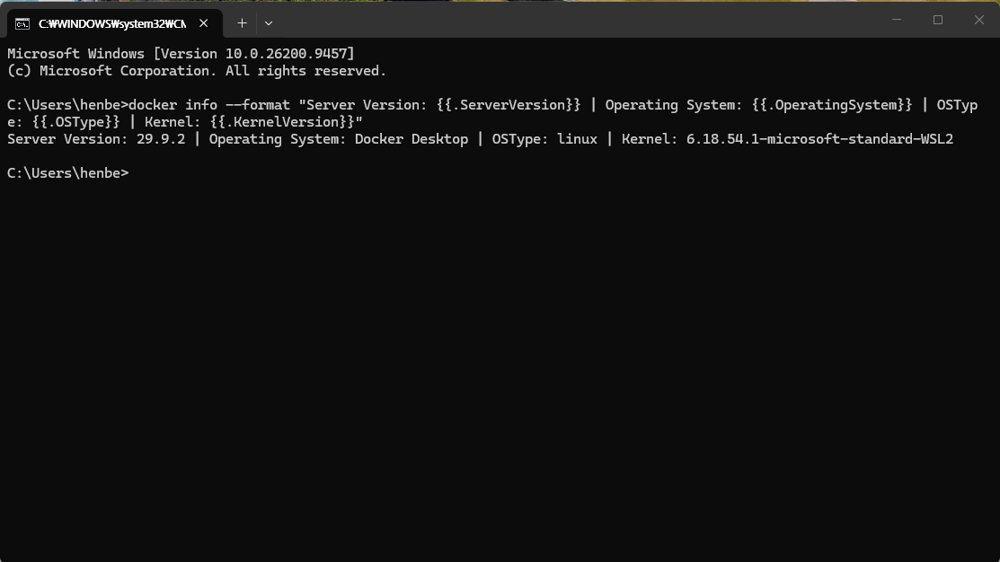

### 빈 파일 생성 확인
`type nul > empty.txt`로 빈 파일을 생성하고,
`dir empty.txt` 출력에서 파일 크기가 0바이트임을 확인했다.

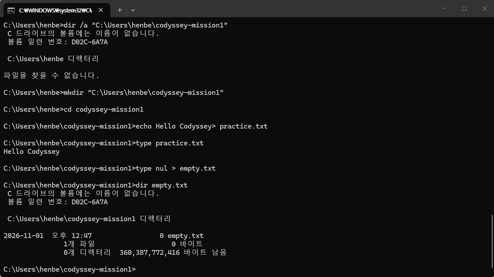

## Windows CMD 파일 관리 실습

아래 명령은 순서대로 직접 실행했다. 별도 출력이 없는 명령은 후속 조회로 결과를 확인했다.

| 명령 | 확인 결과 |
|---|---|
| `cd` | 현재 위치 `C:\Users\henbe` 확인 |
| `dir` | 일반 목록과 `<DIR>` 표시 확인 |
| `dir /a` | 일반 목록보다 항목이 늘어남을 확인 |
| `dir /a "C:\Users\henbe\codyssey-mission1"` | 생성 전 “파일을 찾을 수 없습니다.” 확인 |
| `mkdir "C:\Users\henbe\codyssey-mission1"` | 이후 폴더 이동 성공으로 생성 확인 |
| `cd codyssey-mission1` | 입력 줄이 프로젝트 경로로 변경됨 |
| `echo Hello Codyssey> practice.txt` | 이후 `type`으로 내용 확인 |
| `type practice.txt` | `Hello Codyssey` 출력 확인 |
| `type nul > empty.txt` | 이후 `dir empty.txt`로 0바이트 확인 |
| `copy practice.txt practice-copy.txt` | 복사 성공 메시지 확인 |
| `type practice-copy.txt` | 원본과 같은 내용 출력 확인 |
| `move practice-copy.txt practice-renamed.txt` | 이동 성공 메시지 확인 |
| `dir practice*.txt` | 원본과 이름 변경된 파일 확인 |
| `del practice-renamed.txt` | 이후 목록에서 원본만 남았음을 확인 |
| `mkdir archive` | 이후 파일 이동 성공으로 폴더 사용 확인 |
| `move practice.txt archive\` | 이동 성공 메시지 확인 |
| `type archive\practice.txt` | `Hello Codyssey` 출력 확인 |
| `type "C:\Users\henbe\codyssey-mission1\archive\practice.txt"` | 같은 내용 출력 확인 |

### 실제 출력 기록

이름 변경 후 사용자가 전달한 실제 출력:
```text
2026-11-01  오후 12:46                16 practice-renamed.txt
2026-11-01  오후 12:46                16 practice.txt
               2개 파일                  32 바이트
```

### 절대 경로와 상대 경로

- 절대 경로: `C:\Users\henbe\codyssey-mission1\archive\practice.txt`
- 상대 경로: 프로젝트 폴더에서 사용하는 `archive\practice.txt`
- 두 경로로 같은 파일을 읽어 `Hello Codyssey` 출력을 확인했다.
- 다른 PC에서는 절대 경로의 사용자 폴더 부분을 해당 환경에 맞게 바꿔야 한다.

### 프로젝트 목록 검증

프로젝트 폴더에서 실행한 명령:
```cmd
dir /a
```

실제 출력:
```text
2026-11-01  오후 12:55    <DIR>          .
2026-11-01  오후 12:45    <DIR>          ..
2026-11-01  오후 12:51    <DIR>          archive
2026-11-01  오후 12:47                 0 empty.txt
2026-11-01  오후 01:03             4,366 README.md
2026-11-01  오후 12:58    <DIR>          screenshots
               2개 파일               4,366 바이트
```

이 출력은 조회 당시의 상태이며, 이후 문서 편집에 따라 파일 크기는 달라질 수 있다.
`empty.txt`가 0바이트이고 프로젝트 폴더와 README가 존재함을 확인했다.

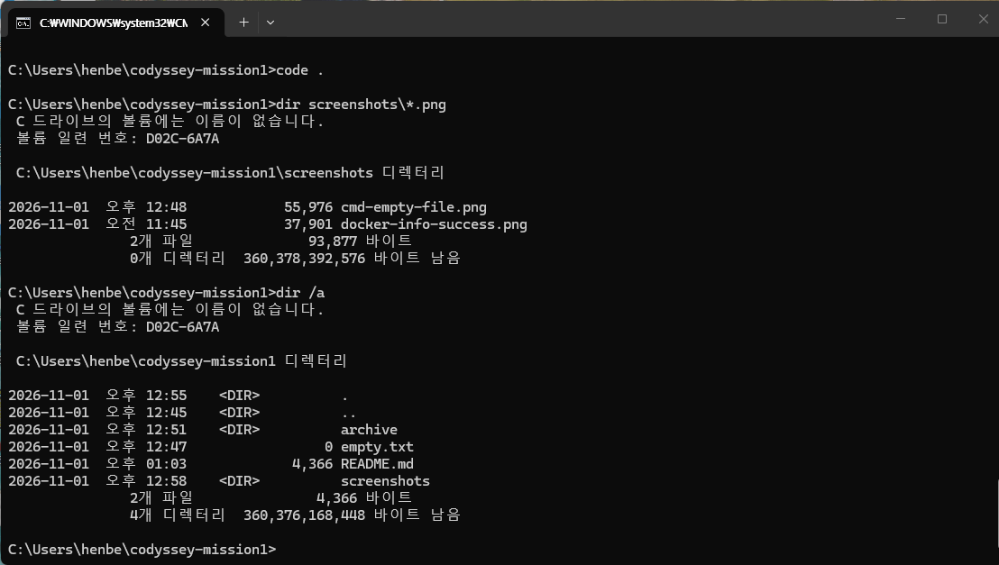

## 트러블슈팅

### 1. Docker 엔진 연결 실패

#### 문제
CMD에서 `docker info`를 실행했지만 서버 정보를 조회하지 못했다.

실제 오류:
```text
failed to connect to the docker API at npipe:////./pipe/dockerDesktopLinuxEngine; check if the path is correct and if the daemon is running: open //./pipe/dockerDesktopLinuxEngine: The system cannot find the file specified.
```

#### 원인 가설
Docker CLI는 설치되어 있지만 Docker Desktop의 Linux 엔진이 아직 실행되지 않았거나 준비되지 않았을 가능성이 있었다.

#### 확인
`docker --version`은 정상 실행됐지만, `docker info`에서는 엔진 연결 오류가 발생했다.
CLI 실행과 엔진 연결은 별도로 확인해야 한다는 점을 관찰했다.

#### 해결
시작 메뉴에서 Docker Desktop을 실행했다.

#### 결과 검증
CMD에서 `docker info`를 다시 실행해 다음 서버 정보를 확인했다.

```text
Server Version: 29.9.2
Operating System: Docker Desktop
OSType: linux
```

Docker Desktop 실행 후 연결이 정상화됐다.
최초 실패 당시 엔진 상태를 별도로 조회하지 않았으므로, 정확한 원인은 확정하지 않는다.

[연결 성공 스크린샷](screenshots/docker-info-success.png)

## Linux 파일·디렉터리 권한 실습

직접 만든 Ubuntu 컨테이너 `codyssey-m1-lab` 내부에서 수행했다.
작업 경로는 `/root/mission1-permissions`이며, 사용자는 `root`이다.

### 준비 명령

```bash
mkdir /root/mission1-permissions
cd /root/mission1-permissions
touch sample.txt
mkdir sample-dir
ls -ld sample.txt sample-dir
```

변경 전 실제 출력:
```text
drwxr-xr-x 2 root root 4096 Nov  1 04:19 sample-dir
-rw-r--r-- 1 root root    0 Nov  1 04:19 sample.txt
```

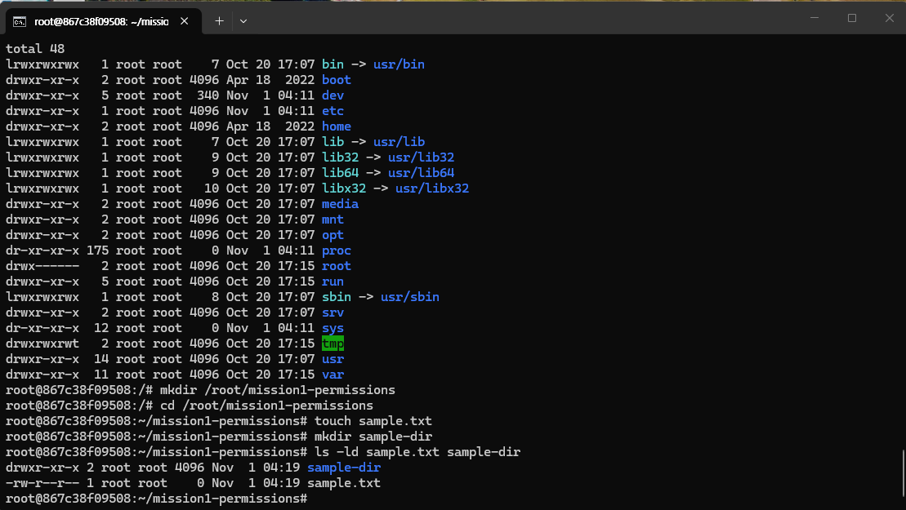

### 파일 권한 변경과 검증

```bash
chmod 700 sample.txt
ls -l sample.txt
```

실제 출력:
```text
-rwx------ 1 root root 0 Nov  1 04:19 sample.txt
```

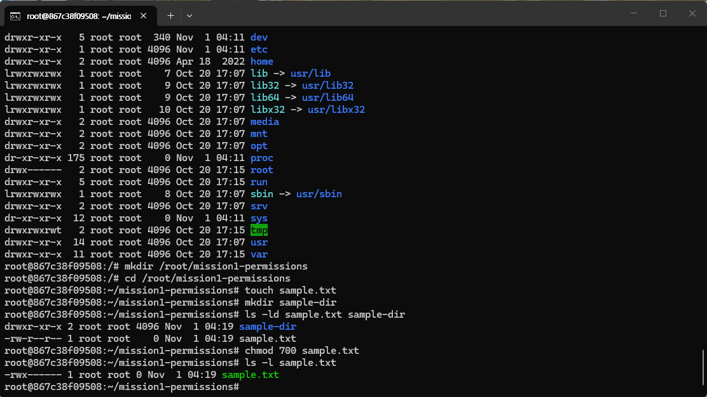

```bash
chmod 644 sample.txt
ls -l sample.txt
```

실제 출력:
```text
-rw-r--r-- 1 root root 0 Nov  1 04:19 sample.txt
```

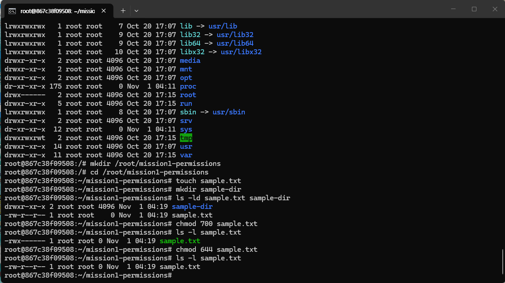

### 디렉터리 권한 변경과 검증

```bash
chmod 700 sample-dir
ls -ld sample-dir
```

실제 출력:
```text
drwx------ 2 root root 4096 Nov  1 04:19 sample-dir
```

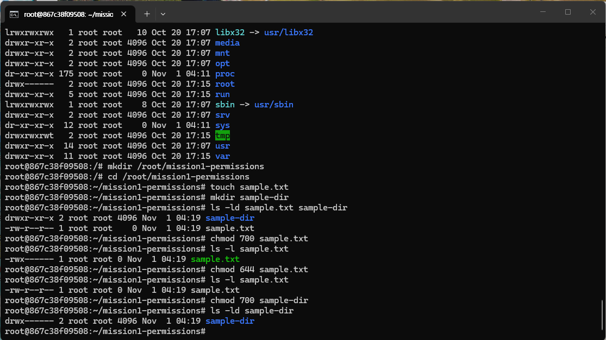

```bash
chmod 755 sample-dir
ls -ld sample-dir
```

실제 출력:
```text
drwxr-xr-x 2 root root 4096 Nov  1 04:19 sample-dir
```

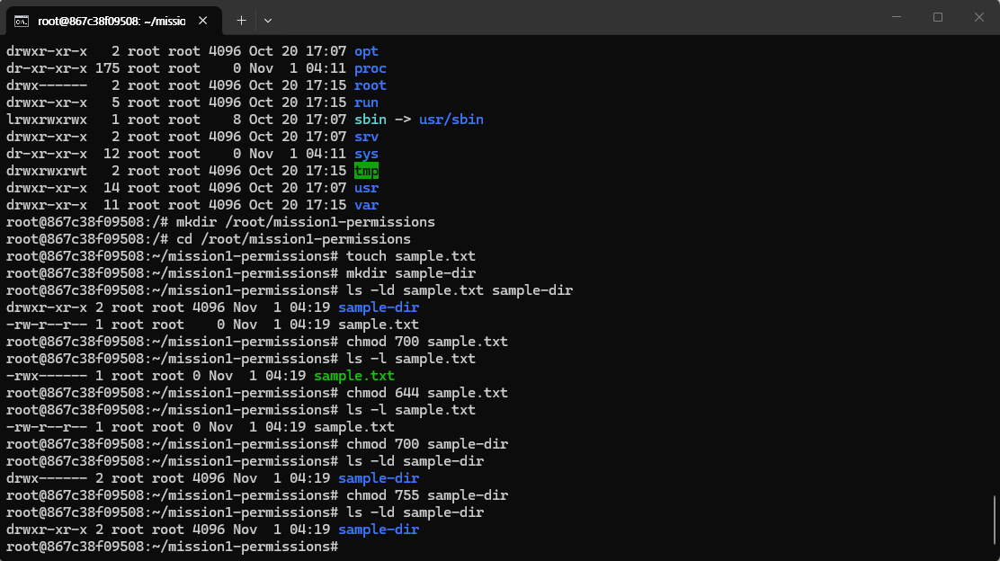

### 권한의 의미

권한은 소유자·그룹·다른 사용자 순서로 표시한다.
`r=4`, `w=2`, `x=1`을 더해 각 자리의 숫자를 계산한다.

- 700: 소유자만 읽기·쓰기·실행 또는 디렉터리 접근 가능
- 644: 소유자는 읽기·쓰기, 나머지는 읽기만 가능
- 755: 소유자는 읽기·쓰기·실행 또는 접근, 나머지는 읽기·실행 또는 접근 가능

디렉터리에서 `r`은 항목 목록 읽기, `w`는 항목 생성·삭제,
`x`는 내부 접근을 뜻한다.
이번 실습은 권한 표시의 변경을 검증했으며, 다른 사용자로 접근을 시험하지는 않았다.

## Docker exec와 attach 비교

### exec: 새 명령 또는 셸 실행

Windows CMD에서 실행:
```cmd
docker exec -it codyssey-m1-lab bash
```

컨테이너 내부에서 실행:
```bash
pwd
```

실제 출력:
```text
/
```

```bash
whoami
```

실제 출력:
```text
root
```

```bash
echo "Hello from Ubuntu"
```

실제 출력:
```text
Hello from Ubuntu
```

```bash
exit
```

Windows CMD로 돌아온 후 실행:
```cmd
docker ps --filter "name=^/codyssey-m1-lab$" --format "table {{.Names}}\t{{.Status}}"
```

실제 출력:
```text
NAMES             STATUS
codyssey-m1-lab   Up 20 minutes
```

`exec`로 연 Bash를 종료해도 기본 프로세스인 `sleep infinity`는 유지됐다.

### attach: 기존 기본 프로세스에 연결

Windows CMD에서 실행:
```cmd
docker attach --sig-proxy=false codyssey-m1-lab
```

새 셸 입력 줄은 나타나지 않고 대기했다.
기본 프로세스가 출력 없이 대기하는 `sleep infinity`이기 때문이다.

Ctrl+C로 연결을 끝내는 과정에서 실제로 다음 메시지가 표시됐다:
```text
got 3 SIGTERM/SIGINTs, forcefully exiting
```

연결 종료 후 확인:
```cmd
docker ps -a --filter "name=^/codyssey-m1-lab$" --format "table {{.Names}}\t{{.Status}}"
```

실제 출력:
```text
NAMES             STATUS
codyssey-m1-lab   Up 2 minutes
```

이번 실행에서는 attach 연결 종료 후에도 컨테이너가 유지됐다.
`--sig-proxy=false`는 터미널의 신호를 컨테이너로 전달하지 않도록 지정한 옵션이다.

### 관찰한 차이
- `exec`: 실행 중인 컨테이너에 새 명령이나 셸을 실행한다.
- `attach`: 컨테이너의 기존 기본 프로세스에 연결한다.
- 컨테이너의 실행 유지 여부는 기본 프로세스의 상태에 따라 달라진다.

## Docker 기본 실행과 운영

### Ubuntu 이미지 준비

```cmd
docker pull ubuntu:22.04
```

실제 출력:
```text
22.04: Pulling from library/ubuntu
Digest: sha256:076e7bf82319619f28dd0aa9c02ab34b055ad37100395b4f49a2ffba04fb5e11
Status: Image is up to date for ubuntu:22.04
docker.io/library/ubuntu:22.04
```

### 실습 컨테이너 생성

```cmd
docker run -d --name codyssey-m1-lab ubuntu:22.04 sleep infinity
```

컨테이너 ID가 출력됐다. 이어서 상태를 확인했다.

```cmd
docker ps -a --filter "name=^/codyssey-m1-lab$" --format "table {{.Names}}\t{{.Image}}\t{{.Status}}"
```

실제 출력:
```text
NAMES             IMAGE          STATUS
codyssey-m1-lab   ubuntu:22.04   Up 35 seconds
```

### hello-world 실행과 정상 종료

```cmd
docker run --name codyssey-m1-hello hello-world
```

`Hello from Docker!` 출력을 확인했다.

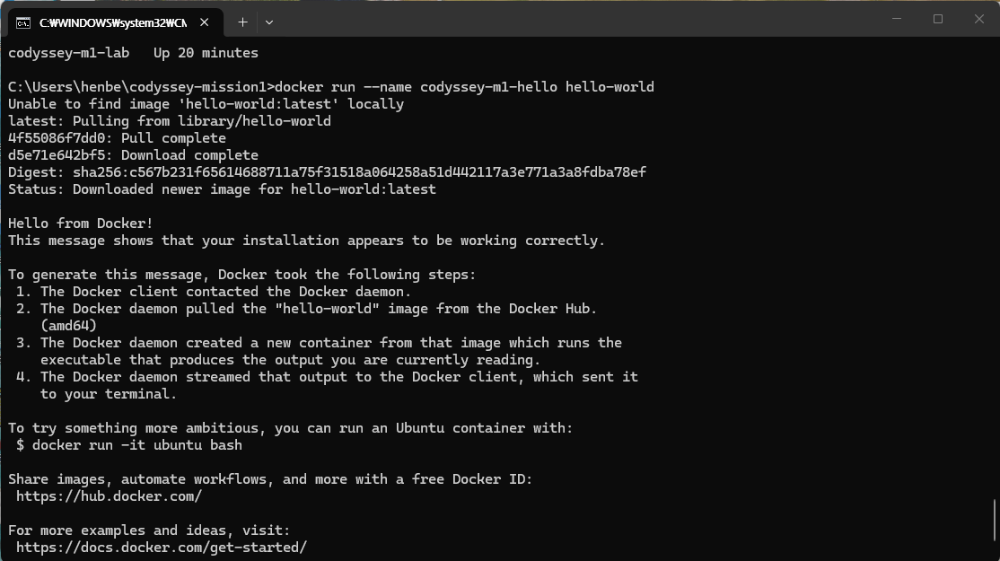

```cmd
docker ps -a --filter "name=^/codyssey-m1-hello$" --format "table {{.Names}}\t{{.Status}}"
```

실제 출력:
```text
NAMES               STATUS
codyssey-m1-hello   Exited (0) 2 minutes ago
```

종료 코드 0으로 정상 종료했다.

### 이미지 목록

```cmd
docker images
```

실제 출력:
```text
IMAGE                ID             DISK USAGE   CONTENT SIZE   EXTRA
hello-world:latest   c567b231f656       25.9kB         9.49kB    U
ubuntu:22.04         076e7bf82319        119MB         31.7MB    U
```

이미지는 실행에 사용하는 재료(READY), 컨테이너는 이미지로 만든 실행 개체(GO)로 이해했다.

### 로그 조회

```cmd
docker logs codyssey-m1-hello
```

종료된 컨테이너에서도 `Hello from Docker!` 안내문을 다시 확인했다.

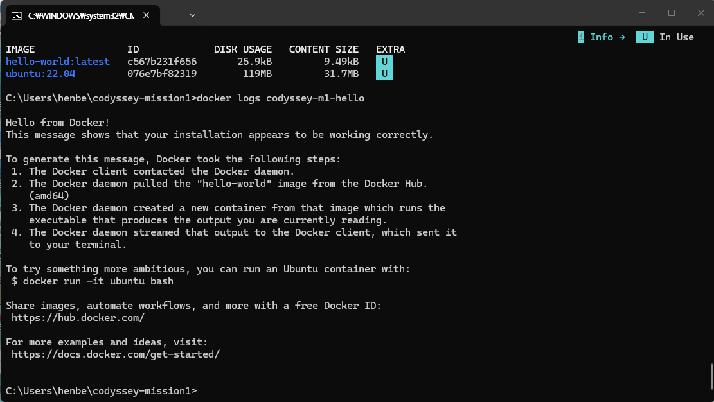

### 리소스 사용량

```cmd
docker stats --no-stream codyssey-m1-lab
```

실제 출력:
```text
CONTAINER ID   NAME              CPU %     MEM USAGE / LIMIT     MEM %     NET I/O         BLOCK I/O        PIDS
867c38f09508   codyssey-m1-lab   0.00%     4.531MiB / 7.666GiB   0.06%     1.74kB / 126B   7.22MB / 4.1kB   1
```

수치는 조회 시점의 값이다.

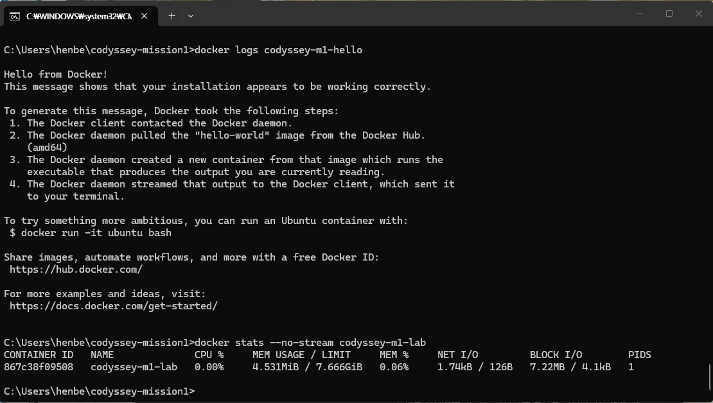

### 중지와 재시작

```cmd
docker stop codyssey-m1-lab
```

실제 출력:
```text
codyssey-m1-lab
```

```cmd
docker ps -a --filter "name=^/codyssey-m1-lab$" --format "table {{.Names}}\t{{.Status}}"
```

실제 출력:
```text
NAMES             STATUS
codyssey-m1-lab   Exited (137) 19 seconds ago
```

중지 상태를 확인했다. 종료 코드 137의 정확한 발생 원인은 별도로 확정하지 않았다.

```cmd
docker start codyssey-m1-lab
```

실제 출력:
```text
codyssey-m1-lab
```

```cmd
docker ps --filter "name=^/codyssey-m1-lab$" --format "table {{.Names}}\t{{.Status}}"
```

실제 출력:
```text
NAMES             STATUS
codyssey-m1-lab   Up 25 seconds
```

### 재시작 후 내부 파일 확인

```cmd
docker exec codyssey-m1-lab ls -ld /root/mission1-permissions/sample.txt /root/mission1-permissions/sample-dir
```

실제 출력:
```text
drwxr-xr-x 2 root root 4096 Nov  1 04:19 /root/mission1-permissions/sample-dir
-rw-r--r-- 1 root root    0 Nov  1 04:19 /root/mission1-permissions/sample.txt
```

같은 컨테이너를 중지·재시작한 뒤에도 파일과 권한이 유지됐다.
컨테이너 삭제 후 데이터 유지 여부는 별도의 볼륨 실습에서 검증한다.

## Dockerfile 기반 커스텀 웹 서버

### 소스와 베이스 이미지
- [직접 작성한 Dockerfile](web/Dockerfile)
- [직접 작성한 웹페이지](web/index.html)
- 베이스 이미지: `nginx:stable-alpine`
- 선택 이유: 정적 HTML 제공에 필요한 NGINX가 준비되어 있고, Alpine 기반으로 구성되어 있어 간단한 웹 서버 실습에 적합하다.
- 커스텀 내용: `COPY`로 기본 페이지를 직접 작성한 HTML로 교체하고, `LABEL`로 프로젝트 제목을 기록했다.
- `EXPOSE 80`은 포트를 문서화하며, 실제 호스트 연결은 실행 시 `-p`로 설정했다.

### 빌드

프로젝트 최상위 폴더에서 실행:
```cmd
docker build -t codyssey-m1-web:1.0 ./web
```

빌드 성공 출력 발췌:
```text
=> [2/2] COPY index.html /usr/share/nginx/html/index.html
=> => naming to docker.io/library/codyssey-m1-web:1.0
=> => unpacking to docker.io/library/codyssey-m1-web:1.0
```

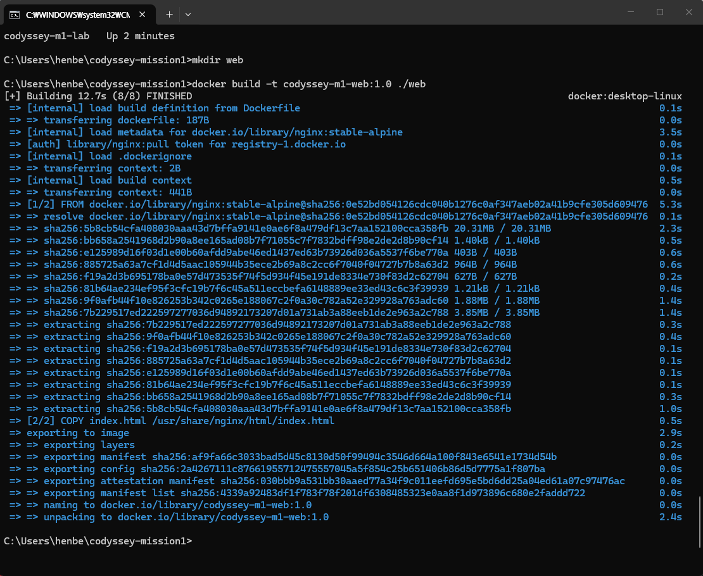

이미지 확인:
```cmd
docker images codyssey-m1-web:1.0
```

실제 출력:
```text
IMAGE                 ID             DISK USAGE   CONTENT SIZE   EXTRA
codyssey-m1-web:1.0   4339a92483df       92.7MB         26.1MB
```

### 내부 서버 설정 확인

```cmd
docker run --rm --entrypoint nginx codyssey-m1-web:1.0 -T
```

실제 출력 발췌:
```text
nginx: the configuration file /etc/nginx/nginx.conf syntax is ok
nginx: configuration file /etc/nginx/nginx.conf test is successful
    listen       80;
        root   /usr/share/nginx/html;
```

내부 서버 포트가 80이고, HTML 제공 경로가 COPY 대상과 일치함을 확인했다.

### 포트 매핑과 실행

```cmd
docker run -d --name codyssey-m1-web-8080 -p 127.0.0.1:8080:80 codyssey-m1-web:1.0
```

```cmd
docker ps -a --filter "name=^/codyssey-m1-web-8080$" --format "table {{.Names}}\t{{.Status}}\t{{.Ports}}"
```

실제 출력:
```text
NAMES                  STATUS          PORTS
codyssey-m1-web-8080   Up 18 seconds   127.0.0.1:8080->80/tcp
```

```cmd
curl -i http://127.0.0.1:8080
```

실제 응답 발췌:
```text
HTTP/1.1 200 OK
Server: nginx/1.30.6
Content-Type: text/html

  <h1>나의 첫 Docker 웹 서버</h1>
  <p>Hello Codyssey!</p>
  <p>NGINX 기반 커스텀 이미지로 실행한 페이지입니다.</p>
  <p id="version">페이지 버전: 1</p>
```

브라우저에서 `http://localhost:8080` 접속을 확인했다.

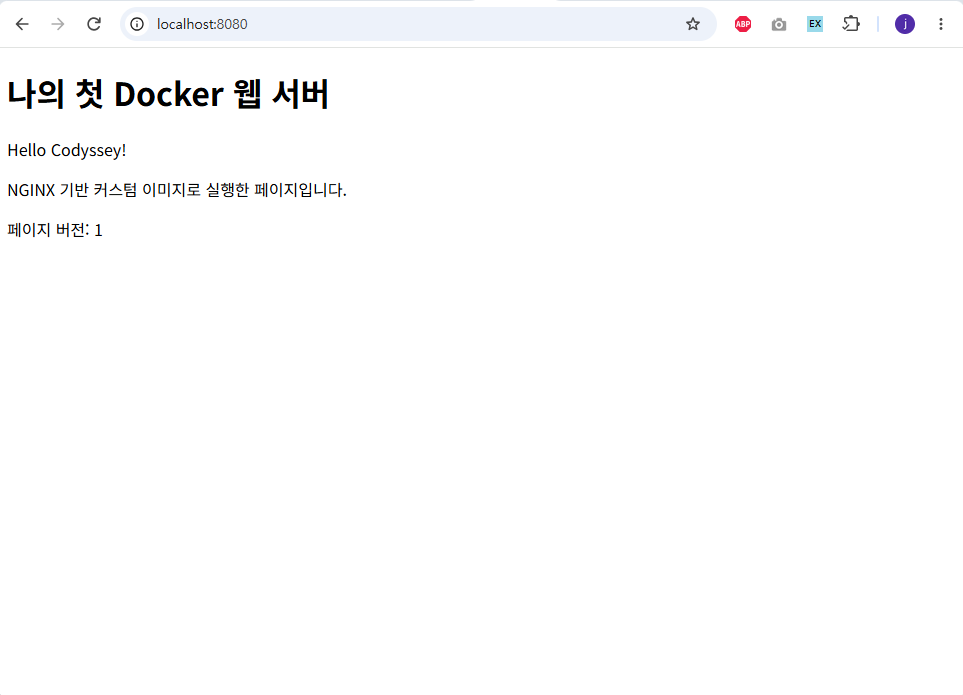

### 웹 서버 로그

```cmd
docker logs --tail 20 codyssey-m1-web-8080
```

실제 로그:
```text
172.17.0.1 - - [01/Nov/2026:04:58:51 +0000] "GET / HTTP/1.1" 200 402 "-" "Mozilla/5.0 (Windows NT 10.0; Win64; x64) AppleWebKit/537.36 (KHTML, like Gecko) Chrome/156.0.0.0 Safari/537.36" "-"
```

### 두 번째 호스트 포트 검증

```cmd
docker run -d --name codyssey-m1-web-8081 -p 127.0.0.1:8081:80 codyssey-m1-web:1.0
```

```cmd
docker ps -a --filter "name=^/codyssey-m1-web-8081$" --format "table {{.Names}}\t{{.Status}}\t{{.Ports}}"
```

실제 출력:
```text
NAMES                  STATUS          PORTS
codyssey-m1-web-8081   Up 19 seconds   127.0.0.1:8081->80/tcp
```

```cmd
curl -i http://127.0.0.1:8081
```

실제 응답 발췌:
```text
HTTP/1.1 200 OK
 <p>Hello Codyssey!</p>
```

브라우저에서 `http://localhost:8081` 접속도 확인했다.

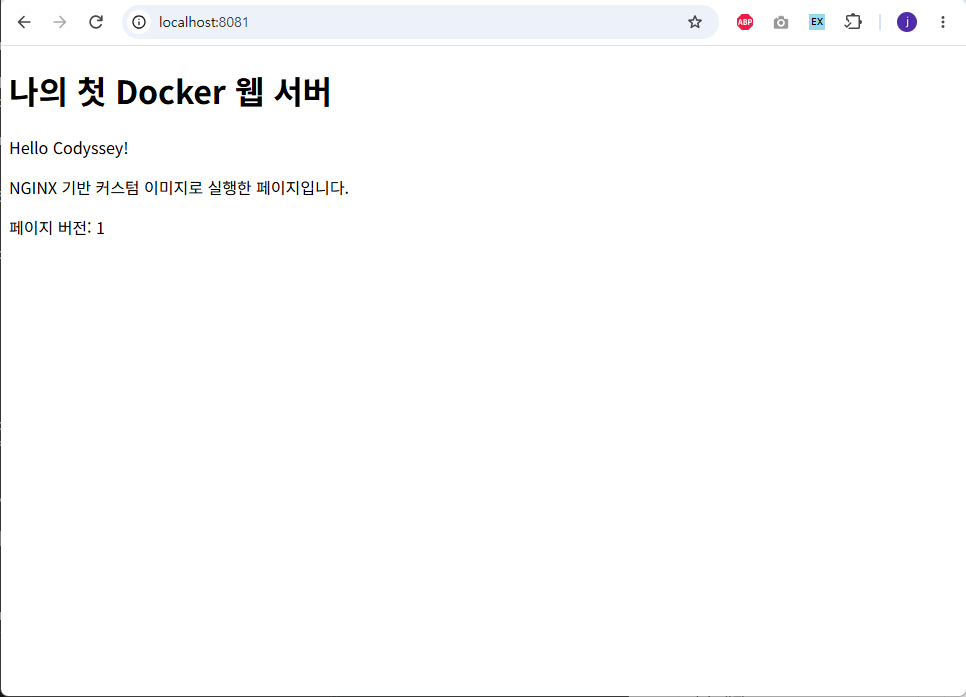

### 포트 매핑을 사용하는 이유
호스트 포트는 Windows에서 접속할 입구이고, 컨테이너 포트는 내부 서버가 요청을 받는 위치다.
각 컨테이너의 NGINX는 내부 포트 80을 사용하지만, 호스트에서는 서로 다른 8080과 8081로 연결했다.
`127.0.0.1`로 바인딩해 이 PC에서 접속하도록 설정했다.

## Docker 볼륨 영속성과 백업

### 볼륨 생성과 연결

```cmd
docker volume create codyssey-m1-data
```

실제 출력:
```text
codyssey-m1-data
```

```cmd
docker run -d --name codyssey-m1-volume-before --mount type=volume,source=codyssey-m1-data,target=/data ubuntu:22.04 sleep infinity
```

컨테이너 ID가 출력됐다.

```cmd
docker inspect --format "{{range .Mounts}}{{.Type}} | {{.Name}} | {{.Destination}}{{end}}" codyssey-m1-volume-before
```

실제 출력:
```text
volume | codyssey-m1-data | /data
```

### 데이터 저장과 삭제 전 확인

```cmd
docker exec codyssey-m1-volume-before sh -c "echo Codyssey volume persistence test > /data/message.txt"
```

```cmd
docker exec codyssey-m1-volume-before cat /data/message.txt
```

실제 출력:
```text
Codyssey volume persistence test
```

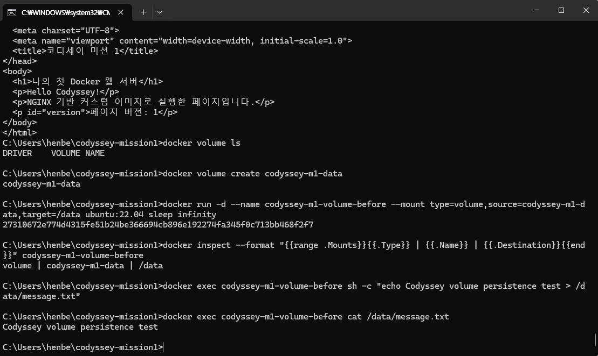

### 첫 컨테이너 삭제

```cmd
docker stop codyssey-m1-volume-before
```

중지 명령이 성공했다.

```cmd
docker rm codyssey-m1-volume-before
```

실제 출력:
```text
codyssey-m1-volume-before
```

```cmd
docker ps -a --filter "name=^/codyssey-m1-volume-before$" --format "table {{.Names}}\t{{.Status}}"
```

제목만 표시되고 컨테이너 행은 없었다.

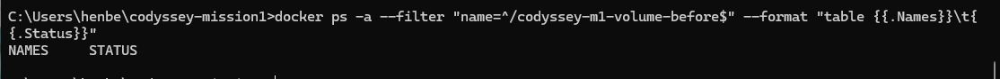

### 새 컨테이너에서 데이터 확인

```cmd
docker run -d --name codyssey-m1-volume-after --mount type=volume,source=codyssey-m1-data,target=/data ubuntu:22.04 sleep infinity
```

컨테이너 ID가 출력됐다.

```cmd
docker exec codyssey-m1-volume-after cat /data/message.txt
```

실제 출력:
```text
Codyssey volume persistence test
```

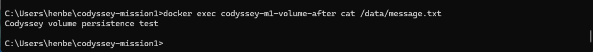

첫 컨테이너를 삭제한 뒤 새 컨테이너에 같은 볼륨을 연결해도 데이터가 유지됐다.
볼륨은 컨테이너와 별도로 관리되는 영속 저장소다.

### 볼륨 백업

프로젝트 최상위 폴더의 Windows CMD에서 실행했다.

```cmd
mkdir backups
```

```cmd
docker run --rm --mount type=volume,source=codyssey-m1-data,target=/data,readonly --mount "type=bind,source=%cd%\backups,target=/backup" ubuntu:22.04 tar -czf /backup/codyssey-m1-data.tar.gz -C /data .
```

볼륨은 읽기 전용으로 연결했고, 백업을 호스트의 `backups` 폴더에 저장했다.
`%cd%`는 CMD의 현재 경로이므로 다른 PC에서도 프로젝트 최상위 폴더에서 실행해야 한다.

```cmd
dir backups\codyssey-m1-data.tar.gz
```

실제 출력 발췌:
```text
2026-11-01  오후 02:14               177 codyssey-m1-data.tar.gz
```

### 백업 목록과 내용 검증

```cmd
docker run --rm --mount "type=bind,source=%cd%\backups,target=/backup,readonly" ubuntu:22.04 tar -tzf /backup/codyssey-m1-data.tar.gz
```

실제 출력:
```text
./
./message.txt
```

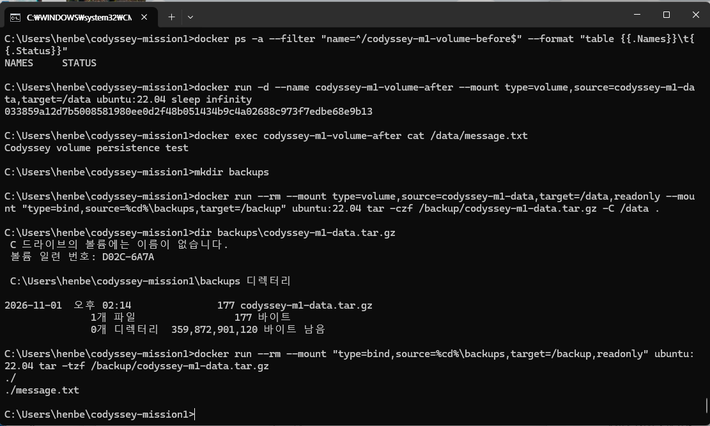

```cmd
docker run --rm --mount "type=bind,source=%cd%\backups,target=/backup,readonly" ubuntu:22.04 tar -xOzf /backup/codyssey-m1-data.tar.gz ./message.txt
```

실제 출력:
```text
Codyssey volume persistence test
```

백업의 파일 목록과 저장 내용을 확인했다.
백업을 새 볼륨에 복원하는 실험은 수행하지 않았다.

[검증한 볼륨 백업 파일](backups/codyssey-m1-data.tar.gz)

## 바인드 마운트 변경 반영

프로젝트 최상위 폴더의 Windows CMD에서 호스트 폴더를 준비했다.

```cmd
mkdir bind-demo
```

초기 파일 생성 과정에서 숫자 1이 누락되는 문제가 발생했다.
아래 명령으로 수정한 뒤 실제 내용을 확인했다.

```cmd
> bind-demo\message.txt echo Bind mount version 1
```

```cmd
type bind-demo\message.txt
```

실제 출력:
```text
Bind mount version 1
```

### 호스트 폴더 연결

```cmd
docker run -d --name codyssey-m1-bind --mount "type=bind,source=%cd%\bind-demo,target=/workspace,readonly" ubuntu:22.04 sleep infinity
```

컨테이너 ID가 출력됐다.
`%cd%`는 CMD의 현재 경로이므로 프로젝트 최상위 폴더에서 실행해야 한다.
호스트의 `bind-demo` 폴더를 컨테이너의 `/workspace`에 읽기 전용으로 연결했다.

### 변경 전

```cmd
docker exec codyssey-m1-bind cat /workspace/message.txt
```

실제 출력:
```text
Bind mount version 1
```

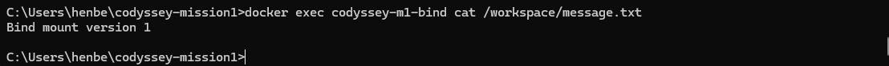

### 호스트 원본 수정

VS Code에서 `bind-demo/message.txt`를 다음 내용으로 바꾸고 저장했다.

```text
Bind mount version 2
```

### 변경 후

컨테이너를 재시작하거나 재생성하지 않고 다시 조회했다.

```cmd
docker exec codyssey-m1-bind cat /workspace/message.txt
```

실제 출력:
```text
Bind mount version 2
```

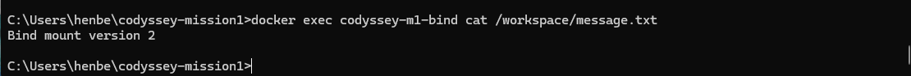

### 확인한 내용

Windows 원본 파일의 변경이 같은 컨테이너에서 바로 보였다.
`readonly`는 컨테이너에서의 쓰기를 제한하며, 호스트에서 수정한 내용은 반영됐다.
바인드 마운트는 직접 지정한 호스트 경로를 연결하고, 볼륨은 Docker가 관리하는 저장소를 연결한다.

## 트러블슈팅 2 — CMD 파일 저장 시 숫자 누락

### 문제
바인드 마운트 실습용 파일을 만들 때 다음 명령을 실행했다.

```cmd
echo Bind mount version 1> bind-demo\message.txt
```

확인 명령:
```cmd
type bind-demo\message.txt
```

실제 출력:
```text
Bind mount version
```

의도한 마지막 숫자 `1`이 누락됐다. 이 명령은 AI 안내에 따라 실행했으며, 의도적으로 재현한 오류는 아니다.

### 원인 가설
CMD가 `1>`을 표준 출력의 리디렉션 문법으로 해석해,
숫자 `1`을 저장할 문자열에 포함하지 않았을 가능성이 있었다.

### 해결
리디렉션을 명령 앞에 배치해 숫자와 분리했다.

```cmd
> bind-demo\message.txt echo Bind mount version 1
```

### 결과 검증

```cmd
type bind-demo\message.txt
```

실제 출력:
```text
Bind mount version 1
```

이후 컨테이너에서도 같은 내용을 읽어 정상 저장을 확인했다.

```cmd
docker exec codyssey-m1-bind cat /workspace/message.txt
```

당시 실제 출력:
```text
Bind mount version 1
```

[수정 후 컨테이너 확인 증거](screenshots/bind-mount-before.png)

현재 파일은 후속 바인드 마운트 실습에서 `Bind mount version 2`로 변경한 상태다.

## 트러블슈팅 3 — Docker 컨테이너 이름 중복

### 문제
오류 처리 학습을 위해 직접 만든 컨테이너의 이름을 다시 사용했다.
이번 오류는 의도적으로 재현했다.

```cmd
docker run -d --name codyssey-m1-bind ubuntu:22.04 sleep infinity
```

실제 오류 발췌:
```text
docker: Error response from daemon: Conflict. The container name "/codyssey-m1-bind" is already in use by container "3dd25ec0e6e8af399581024d4889be14094b409085de36ddc9e3383dc10c0574". You have to remove (or rename) that container to be able to reuse that name.
```

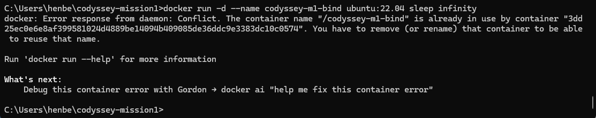

### 원인 가설과 확인
같은 이름의 컨테이너가 이미 존재해 새 컨테이너를 만들 수 없다고 판단했다.
```cmd
docker ps -a --filter "name=^/codyssey-m1-bind$" --format "table {{.Names}}\t{{.Status}}"
```

실제 출력:
```text
NAMES              STATUS
codyssey-m1-bind   Up 7 minutes
```

### 해결
기존 컨테이너를 삭제하거나 변경하지 않고 새 이름을 사용했다.

```cmd
docker run -d --name codyssey-m1-name-check ubuntu:22.04 sleep infinity
```

컨테이너 ID가 출력됐다.

### 결과 검증

```cmd
docker ps -a --filter "name=^/codyssey-m1-name-check$" --format "table {{.Names}}\t{{.Status}}"
```

실제 출력:
```text
NAMES                    STATUS
codyssey-m1-name-check   Up 19 seconds
```

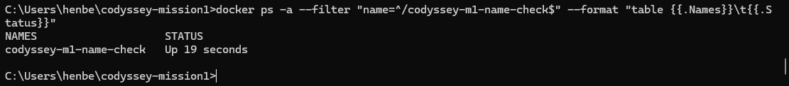

새 이름으로 정상 실행됐다.
Docker 엔진 연결 오류와 이번 이름 중복 오류로 Docker 관련 트러블슈팅 2건을 기록했다.

## Git 설정 및 VS Code GitHub 연동

### 저장소와 작성자 설정

프로젝트 폴더에서 `git status`를 실행해 기존 Git 저장소가 아님을 확인한 뒤 생성했다.

```cmd
git init -b main
```

실제 출력:
```text
Initialized empty Git repository in C:/Users/henbe/codyssey-mission1/.git/
```

작성자 이름과 GitHub 비공개 커밋 이메일은 저장소 범위로 설정했다.
아래의 꺾쇠 부분은 설명용 자리표시자이며, 실제 실행 시 본인 값으로 대체했다.

```text
git config --local user.name "<본인 이름 또는 닉네임>"
git config --local user.email "<본인의 GitHub noreply 이메일>"
```

```cmd
git config --local --list
```

출력에서 작성자 이름과 이메일이 의도한 값과 일치함을 직접 확인했다.
개인정보 보호를 위해 실제 값은 이 문서에 싣지 않았다.

```cmd
git config --local init.defaultBranch main
git branch --show-current
```

브랜치 조회의 실제 출력:
```text
main
```

```cmd
git config --list
```

출력의 마지막 항목에서 다음 값을 확인했다.
전체 출력은 공개하지 않고 확인한 항목만 발췌한다.

```text
init.defaultbranch=main
```

### 기존 GitHub 저장소 연결

```cmd
git remote -v
```

최초 조회에서는 출력이 없어 기존 원격 연결이 없음을 확인했다.

```cmd
git ls-remote --heads https://github.com/jjerygirl-tech/ia-codyssey.git
```

실제 출력:
```text
e1824472d4bcf78fccb5a5e9426ced91323a14f4        refs/heads/main
```

```cmd
git remote add origin https://github.com/jjerygirl-tech/ia-codyssey.git
git remote -v
```

실제 출력:
```text
origin  https://github.com/jjerygirl-tech/ia-codyssey.git (fetch)
origin  https://github.com/jjerygirl-tech/ia-codyssey.git (push)
```

```cmd
git fetch origin
```

기존 main 브랜치의 기록을 origin/main으로 가져왔다.

### 기존 커밋 보존

기존 GitHub README를 현재 파일에 덮어쓰지 않고 조회했다.

```cmd
git show origin/main:README.md
```

실제 출력:
```text
# ia-codyssey2
Github과 Codyssey를 연동하기 위해 만들어진 Repository입니다
```

로컬에 커밋이나 스테이징된 파일이 없음을 확인한 후, 기존 커밋을 출발점으로 연결했다.

```cmd
git reset --mixed origin/main
```

실제 출력:
```text
Unstaged changes after reset:
M       README.md
```

`--mixed`를 사용해 현재 작성한 README와 실습 파일의 내용을 유지했다.
기존 README는 이전 커밋에서 확인할 수 있다.

```cmd
git status
```

실제 출력:
```text
On branch main
Changes not staged for commit:
  (use "git add <file>..." to update what will be committed)
  (use "git restore <file>..." to discard changes in working directory)
        modified:   README.md

Untracked files:
  (use "git add <file>..." to include in what will be committed)
        archive/
        backups/
        bind-demo/
        empty.txt
        screenshots/
        web/

no changes added to commit (use "git add" and/or "git commit -a")
```

### VS Code GitHub 연동

VS Code의 계정 메뉴에서 GitHub 로그인 상태를 확인했다.
Source Control에서 프로젝트의 변경 파일 목록과 `main` 브랜치 표시를 확인했다.

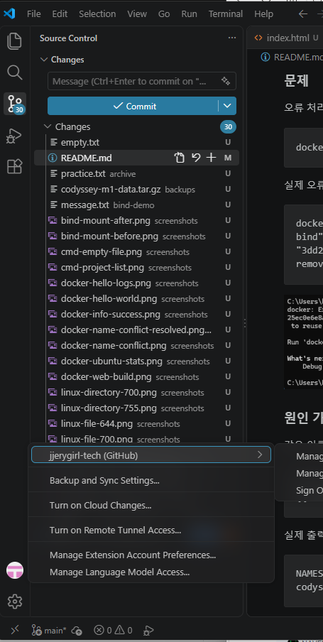

원격 저장소 주소 등록과 기존 기록 가져오기는 완료했다.
커밋과 Push 성공 여부는 후속 실습에서 검증한다.

## 프로젝트 구조

Windows CMD에서 `tree /f`로 실제 파일 구성을 확인했다.

```text
codyssey-mission1/
├─ README.md
├─ empty.txt
├─ archive/
│  └─ practice.txt
├─ backups/
│  └─ codyssey-m1-data.tar.gz
├─ bind-demo/
│  └─ message.txt
├─ screenshots/
│  └─ 실습 증거 PNG 24개
└─ web/
   ├─ Dockerfile
   └─ index.html
```

- `archive/practice.txt`: CMD 파일 관리 실습 파일
- `empty.txt`: 0바이트 빈 파일 생성 증거
- `backups/`: 목록과 내용을 검증한 볼륨 백업
- `bind-demo/message.txt`: 현재 내용은 `Bind mount version 2`
- `screenshots/`: README 각 실습 절에서 연결한 증거 이미지
- `web/`: 직접 작성한 Dockerfile과 웹페이지

## 재현 방법과 주의사항

1. Git, VS Code, Docker와 Linux 컨테이너 실행 환경을 준비한다.
2. 이 저장소를 내려받고 프로젝트 최상위 폴더를 Windows CMD에서 연다.
3. Docker 엔진 연결을 확인한다.
4. 각 실습 절에 기록한 명령을 해당 절의 순서대로 실행한다.
5. 웹 서버는 `web/Dockerfile`로 이미지를 빌드한 뒤 실행한다.
6. 브라우저에서 `http://localhost:8080`과 `http://localhost:8081`에 접속해 직접 작성한 페이지를 확인한다.
7. 볼륨 실습에서는 삭제 전후 파일 내용을 비교한다.
8. 바인드 마운트 실습에서는 호스트 파일 수정 전후의 컨테이너 출력을 비교한다.

### 환경에 따른 조정

- Windows 경로의 사용자명은 본인의 환경에 맞게 변경한다.
- `%cd%`는 Windows CMD 문법이며, 프로젝트 최상위 폴더에서 사용한다.
- Linux 내부 명령은 Ubuntu 컨테이너에서 실행한다.
- 컨테이너·볼륨 이름이 이미 존재하면 기존 소유자와 용도를 확인하고 새 이름을 사용한다.
- 호스트 포트가 사용 중이면 빈 포트로 바꾸고 접속 주소도 함께 변경한다.
- `bind-demo/message.txt`의 제출 시점 내용은 `Bind mount version 2`이다. 변경 전후 실습을 재현하려면 먼저 버전 1로 저장한다.
- 이미지 태그의 내용은 향후 갱신될 수 있으므로 버전·이미지 ID·출력은 이번 기록과 달라질 수 있다.
- 기존 사용자 파일과 Docker 자원은 임의로 삭제하지 않는다.
- 로그와 스크린샷에 비밀번호·토큰·개인키·인증 코드를 포함하지 않는다.

## Ubuntu 내부 목록 조회 로그

Ubuntu 컨테이너의 `/`에서 실행했다.

```bash
ls
```

실제 출력:
```text
bin  boot  dev  etc  home  lib  lib32  lib64  libx32  media  mnt  opt  proc  root  run  sbin  srv  sys  tmp  usr  var
```

```bash
ls -a
```

실제 출력:
```text
.   .dockerenv  boot  etc   lib    lib64   media  opt   root  sbin  sys  usr
..  bin         dev   home  lib32  libx32  mnt    proc  run   srv   tmp  var
```

`-a`를 사용하자 숨김 항목인 `.dockerenv`도 표시됐다.

```bash
ls -l
```

실제 출력 발췌:
```text
lrwxrwxrwx   1 root root    7 Oct 20 17:07 bin -> usr/bin
drwxr-xr-x   2 root root 4096 Apr 18  2022 boot
drwxr-xr-x   5 root root  340 Nov  1 04:11 dev
```

`-l`로 권한·소유자·크기 등을 확인했다.
맨 앞의 `l`은 심볼릭 링크, `d`는 디렉터리를 뜻한다.

## GitHub 업로드 검증

### 스테이징과 검사

```cmd
git add README.md archive backups bind-demo empty.txt screenshots web
git diff --cached --shortstat
```

실제 출력:
```text
31 files changed, 1203 insertions(+)
```

```cmd
git diff --cached --check
```

출력이 없어 공백 오류가 발견되지 않았다.

### 커밋

```cmd
git commit -m "Complete mission 1 practice and evidence"
```

실제 출력:
```text
[main 67e6cf3] Complete mission 1 practice and evidence
31 files changed, 1203 insertions(+)
```

### Push와 원격 검증

```cmd
git push -u origin main
```

사용자가 전달한 실제 출력:
```text
branch 'main' set up to track 'origin/main'.
Everything up-to-date
```

이 출력에는 커밋 전송 내역이 없어, 원격 브랜치를 별도로 조회했다.

```cmd
git ls-remote origin refs/heads/main
```

실제 출력:
```text
67e6cf34eba212d21b6ff81b22abc0f475dcdd91        refs/heads/main
```

원격 main이 실습 결과 커밋을 가리키는 것을 확인했다.

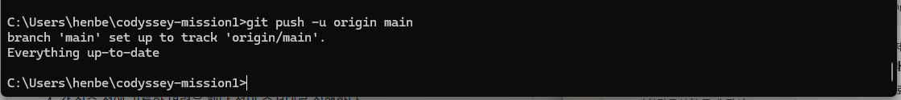

GitHub 웹페이지에서도 제출 폴더와 README 이미지가 표시되는 것을 확인했다.
브라우저 자동 번역으로 문장이 다르게 보였으나, 원문 보기로 전환하자 로컬 문서와 같아졌다.

이 절과 Push 캡처는 첫 업로드 이후 추가한 자료이므로 후속 커밋으로 반영한다.